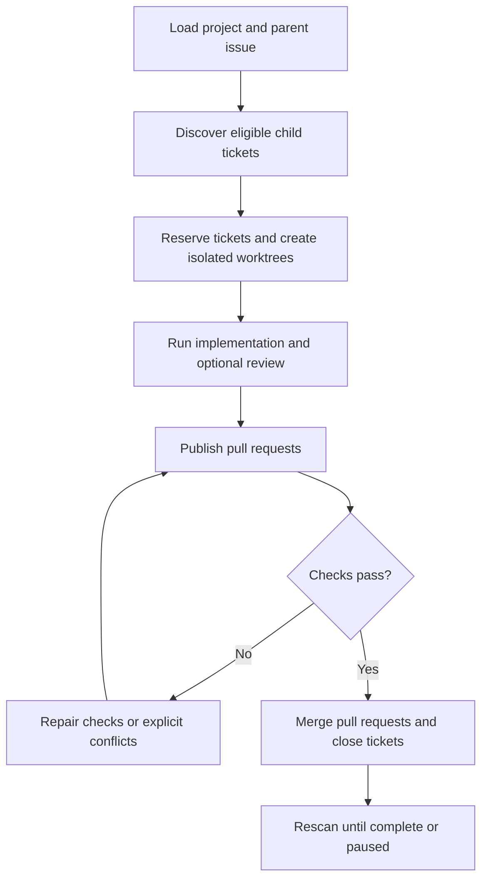

# Sandcastle Runner

Sandcastle Runner is a local CLI that takes a configured GitHub parent issue, finds eligible child tickets, runs isolated implementation and review attempts, publishes pull requests, repairs required checks or merge conflicts, and confirms ticket closure.

## Workflow



## Installation contract

Sandcastle Runner is a checkout-only CLI. Clone this repository, install its
locked dependencies, and invoke the local executable through npm:

```sh
git clone https://github.com/xiakeng/sandcastle-runner.git
cd sandcastle-runner
npm ci
npm exec -- sandcastle-runner run --project <project-key> (--parent <issue-number> | --issue [<issue-number>] | --document) [--auto-merge | --no-auto-merge]
```

The Runner is not published to a package registry, globally installed, invoked
through a remote `npx`, distributed as a native installer, or bundled with
Node.js, npm, Git, GitHub CLI, or the selected coding-agent CLI. Install those
external prerequisites separately for your operating system. `npm ci` and local
`npm exec` are the only supported Runner installation and invocation path.

## Prerequisites

Every host needs the following in the same terminal that runs the Runner:

- Node.js **>=22.18.0**. npm is the version bundled with Node.js; do not use a
  separate global npm to satisfy this requirement.
- Git, with `git` directly runnable on `PATH` (Git worktrees are required).
- GitHub CLI (`gh`), with `gh` directly runnable on `PATH`.
- An installed and authenticated coding-agent CLI for every configured agent,
  directly runnable on `PATH`. Runner supports the native Sandcastle
  `codex`, `claude-code`, and `pi` agents; it does not support OpenCode, Cursor,
  or Copilot. These are existing Sandcastle capabilities, not custom Runner
  integrations. Runner adds no dedicated excluded-agent allowlist or
  compatibility guard; an unknown agent name still fails through ordinary
  configuration or execution error handling.
- A GitHub repository checkout at an absolute path.

Paths containing Chinese characters are unsupported for the Runner checkout,
the selected project's Git checkout, Worktrees, state and log directories,
temporary files, or agent session state. Keep these paths free of Chinese
characters.

Missing executables fail on first use through the existing logical-command error
path. The Runner does not start an interactive `gh auth` flow. Prepare and
authenticate each selected agent with its own CLI instructions, including any
skills, MCP servers, and native configuration its prompts expect; Runner does
not install, migrate, or normalize those environments. Keep any API key or
local sign-in credential in the process environment, never in `config.yaml`.
Runner defines no universal agent CLI version floor.

### macOS

Install Node.js 22.18.0 or newer from the [Node.js macOS download](https://nodejs.org/en/download), or use a maintained package manager such as Homebrew. npm is bundled with Node.js. Install Git with [Xcode Command Line Tools](https://developer.apple.com/library/archive/technotes/tn2339/_index.html), the [Git macOS installer](https://git-scm.com/install/mac), or your package manager. Install `gh` using the [GitHub CLI macOS instructions](https://github.com/cli/cli#installation), and install each selected coding-agent CLI (for example Codex, Claude Code, or Pi) with its own instructions.

After installation, open the terminal profile used for Runs and verify (the
agent checks below use Codex as an example; verify the CLI you configured):

```sh
node --version       # must be v22.18.0 or newer
npm --version
git --version
gh --version
codex --version
codex login status
command -v node npm git gh codex
```

Set the credential variable named by both `tracker.tokenEnv` and
`codeHost.tokenEnv` in `config.yaml` (the template uses `GH_TOKEN`) before
starting the Run:

```sh
export GH_TOKEN='your-github-token'
```

Put the export in the shell profile only if that is appropriate for the host,
and never commit the token. Do not run `gh auth login`; the configured
environment token is passed to the non-interactive GitHub operations.

### Windows (native PowerShell)

Install Node.js 22.18.0 or newer with the [Node.js Windows installer](https://nodejs.org/en/download) or a maintained Windows package manager. npm is bundled with Node.js. Install [Git for Windows](https://git-scm.com/install/windows), `gh` from the [GitHub CLI Windows instructions](https://github.com/cli/cli#installation), and each selected coding-agent CLI using its own instructions. Reopen PowerShell after installation so the installers' `PATH` changes take effect.

Verify the commands in the PowerShell session used for Runs (the agent checks
below use Codex as an example; verify the CLI you configured):

```powershell
node --version       # must be v22.18.0 or newer
npm --version
git --version
gh --version
codex --version
codex login status
Get-Command node, npm, git, gh, codex | Select-Object Name, Source
```

`Get-Command npm` must resolve to the npm bundled with the selected Node.js
installation. If a separate global npm shadows it, prepend the Node.js
installation directory to `PATH` for the Run terminal or invoke the bundled
`npm.cmd` directly. Do not replace the machine-wide npm installation.

Set the configured credential variable for the session, or persist it for
future sessions with the normal Windows environment-variable controls:

```powershell
$env:GH_TOKEN = 'your-github-token'
# Optional persistent setup (open a new PowerShell afterwards):
setx GH_TOKEN "your-github-token"
```

The variable name must match `tracker.tokenEnv` and `codeHost.tokenEnv` in
`config.yaml`. Do not run interactive `gh auth login` or commit the token.
The process environment must contain both configured variables even when
`gh auth status` reports a stored login.

The selected project's `checkout` must already exist and be a Git checkout at a
real absolute Windows path. Use YAML quoting that preserves backslashes, for
example:

```yaml
checkout: 'C:\work\repos\example'
```

Enable long paths in the selected repository only when its files require them.
The setting must be repository-local because Agent Attempts run with isolated
Git configuration:

```powershell
git -C 'C:\work\repos\example' config core.longpaths true
```

### Linux

Install Node.js 22.18.0 or newer from the [Node.js Linux download](https://nodejs.org/en/download), or from a maintained distribution/package-manager source. npm is bundled with Node.js. Install Git from the distribution or the [Git Linux instructions](https://git-scm.com/install/linux), `gh` from the [GitHub CLI Linux instructions](https://github.com/cli/cli#installation), and each selected coding-agent CLI using its own instructions. Keep each executable on the `PATH` of the shell that starts the Runner.

Verify the commands (the agent checks below use Codex as an example; verify the
CLI you configured):

```sh
node --version       # must be v22.18.0 or newer
npm --version
git --version
gh --version
codex --version
codex login status
command -v node npm git gh codex
```

Set the credential variable named in `config.yaml` before invoking the Runner:

```sh
export GH_TOKEN='your-github-token'
```

Use a shell profile or another local secret mechanism only when appropriate;
never commit the token. Interactive `gh auth` is not used.

These instructions describe the checkout contract on the three native OS
families. They do not promise a broader OS or tool-version matrix,
WSL-specific behavior, or a live authenticated agent compatibility guarantee.
The configured repository and tracker must use GitHub; the Runner mutates
issues, branches, worktrees, pull requests, and merges, so use a test repository
when experimenting.

## Configuration and usage

Create a project directory with this layout:

```text
projects/<project-key>/
├── config.yaml
├── prompts/
│   ├── implement.md
│   ├── review.md
│   ├── ci-repair.md
│   ├── conflict-repair.md
│   └── documentation.md
└── logs/
```

Start from [`projects/trickplay-cropper`](projects/trickplay-cropper) and set the repository, absolute checkout, target branch, credential variable, agent profiles, timeouts, and workflow flags in `config.yaml`. Enabled workflow nodes require their prompt file; implementation and repair prompts must be non-empty. Configuration files use YAML and support `#` comments.

Each `agents.<purpose>` profile requires a nonempty `agent` and `model` string
and accepts an optional native `options` object. Native options are forwarded
to the selected Sandcastle factory without renaming, flattening, or
translation:

```yaml
agents:
  implement:
    agent: codex
    model: gpt-6-sol
    options:
      effort: max
  review:
    agent: claude-code
    model: claude-opus-4-8
    options:
      effort: high
  ciRepair:
    agent: pi
    model: claude-sonnet-4-6
    options:
      thinking: high
  conflictRepair:
    agent: codex
    model: gpt-6-sol
    options:
      effort: medium
  documentation:
    agent: claude-code
    model: claude-opus-4-8
    options:
      effort: high
workflow:
  review: true
  docMaintainTriggerLabel: doc-check
```

Agent identity, model naming, and workflow purpose are distinct: `agent`
selects the native Sandcastle factory, `model` is passed to it verbatim, and
each of the five purpose keys selects which profile an operation uses. A model
prefix never selects the agent, and changing agents does not translate or
promise the previous native options remain valid. `review` and `documentation`
profiles are required only when their workflow feature is enabled; a supplied
profile is still validated when disabled. Automatic and `--document`
Documentation Maintenance both use `agents.documentation`.

Codex-backed profiles migrated from older configuration must add `agent` and
move the former `reasoningEffort` value verbatim into `options.effort`, even
when other new fields are present. Runner rejects the obsolete field; it adds
no default agent, model, or options and performs no automatic conversion.
Existing model strings and option values, including `max`, are preserved
exactly. For example:

```yaml
# Rejected legacy profile
model: gpt-6-sol
reasoningEffort: max

# Direct migration
agent: codex
model: gpt-6-sol
options:
  effort: max
```

Each Project may use a different supported agent for each workflow purpose.
Runner itself does not read `CODEX_HOME` or derive a session lookup path from
the operating-system home directory on the selected agent's behalf.
Sandcastle's native default lookup may use the selected agent's conventional
storage location. If that default does not match where the agent actually
stores sessions, set the native lookup root in that purpose's `options`:

```yaml
options:
  sessionStorage:
    hostSessionsDir: 'C:\work\agent-sessions\sessions'
```

Codex and Pi use `hostSessionsDir`; Claude Code uses `hostProjectsDir`. This
option selects where sessions are looked up; it does not relocate the agent's
own storage. Whether an override is necessary depends on whether the default
lookup matches actual storage, not on the operating system alone. Correct
default installations may need no override. The former automatic Codex
directory discovery is removed.

Every Agent Attempt starts with a `SESSION_READY` probe using the selected
profile, then resumes that same session for the substantive work. Sandcastle
owns invocation and session resumption; Runner owns bounded retry and Operator
Pause policy. When automatic recovery cannot continue, Operator Pause shows the
selected agent, session ID when available, working directory, diagnostic log,
and the Runner actions currently permitted. The log path is shown even when a
session ID is available. Missing session identity enters manual handling; Runner
does not start a replacement conversation, migrate transcripts between agents,
or add durable conversation recovery. Runner does not print a copyable
agent-specific resume command; to take over manually, use the selected agent's
own recovery interface with the displayed session, working directory, and
diagnostic log.

Agent Attempt task identities are passed as native Sandcastle run names and
identify tasks in log output. They do not guarantee Runner-assigned titles in
the agent application's session list. This loss is intentional.
Guaranteed Runner-assigned application-session titles, automatic Codex
directory discovery, and copyable manual resume commands are accepted losses;
explicit native lookup, native run names, and displayed diagnostics replace
them.

Runner treats an ordinary substantive Sandcastle invocation failure as generic;
it does not classify failures by agent name, provider error text, `429`/network
wording, or raw provider events. After successful process settlement, Runner
resumes the same probed session when the session ID is usable, cancellation or
timeout has not stopped the attempt, and the Agent Retry budget remains.
Exhaustion or a missing session enters manual handling without a
fresh-conversation fallback. Some authentication or configuration failures may
therefore consume this bounded budget before pausing. A schema-valid successful
result still proceeds through normal outcome and Git verification even if its
output text contains an internal provider error. Native structured-output
retries do not cover all invocation failures; Runner's bounded same-session
correction is a separate path.

Successful process settlement also gates every other automatic follow-up,
including initial-probe retries, same-session invocation retries,
missing-output continuation, structured-output correction, and the first
substantive invocation after a completed probe. If settlement fails or remains
unconfirmed, Runner launches no further process and enters manual handling with
the cleanup evidence.

The required Retry Policy follows
[ADR-0001](docs/adr/0001-configurable-retry-policy.md): `operationRetry` and
`agentRetry` are additional attempts after the initial attempt, and the
`*Delay` arrays are seconds with the final delay reused. Agent-session probes
use Operation Retry; recoverable same-session execution, missing-output, and
structured-output correction use Agent Retry. Operator Pause retries are
manually controlled and consume neither budget. The substantive total deadline
spans automatic retries, delays, continuations, and corrections.

Install dependencies and run a parent issue:

```sh
npm ci
npm exec -- sandcastle-runner run --project <project-key> (--parent <issue-number> | --issue <issue-number> | --document)
```

The command ends with a human-readable report of every processed Delivery and
Maintenance Ticket, followed by any remaining discovery reasons, Retained
Worktrees, and the Audit Log path. `succeeded` and `no_work` exit with status 0;
`incomplete`, `cancelled`, and `failed` exit non-zero.

By default, a standalone Run requests a merge after its Pull Request is CI-ready. With `--no-auto-merge`, the Runner creates and validates the Pull Request, then removes the Worktrees and local branches created by the current Run for that ticket, along with its Agent logs. It retains the remote branch, Reservation, Pull Request, and Recovery Snapshot, reports `PR ready`, and requests neither merge nor closure. Explicit auto-merge flags require a value-bearing `--issue <issue-number>` and accept no value.

`--document` runs one fresh, complete Documentation Maintenance occurrence for the selected Project without a Parent Ticket or Delivery Ticket scope. It ignores `issueList`, does not resume prior maintenance recovery, and may be used when the automatic trigger label is empty.
It uses the configured `agents.documentation` profile.

## Local development

```sh
npm ci
npm test                 # run tests
npm run check            # format check, lint, and typecheck
npm run typecheck        # TypeScript build-time validation
npm run verify           # tests plus all checks
npm run format           # format source files
```

Repository text files are checked out with LF line endings through
`.gitattributes`, including on Windows hosts configured with
`core.autocrlf=true`. This keeps the documented checkout compatible with the
format check.

The test suite uses scripted tracker, code-host, Git, agent, clock, and terminal
boundaries. It does not call authenticated agent/Sandcastle services or mutate a
remote GitHub repository. Native-factory assertions and harmless local-process
lifecycle tests prove the tested contracts only; they do not establish live
authenticated compatibility with any agent, every OS, or cleanup of arbitrary
detached descendants, independently managed servers, or remote jobs.

The generic host executor owns each Agent process it launches and uses
OS-bound process-tree termination. Runner waits for an explicit settlement
result after every invocation. Pending settlement blocks the next automatic
probe, task, or output correction; failed settlement enters the existing manual
handling path instead of starting another writer in the same Worktree. This
does not claim termination of arbitrary detached descendants, independently
managed servers, or remote jobs.

Cancellation stops probe retries, execution retries, retry backoff,
missing-output recovery, and structured-output correction after owned-process
settlement. A substantive timeout uses one total deadline across those
automatic steps, then waits for settlement and enters Operator Pause without
automatically restarting the timed-out invocation.
