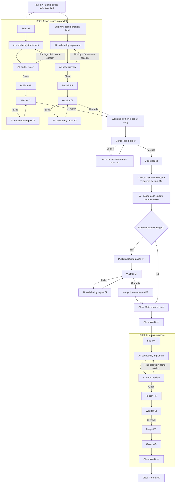

# Sandcastle Runner

Sandcastle Runner is a local CLI that uses code to manage the routine steps of
delivering GitHub tickets. It selects eligible tickets, prepares isolated
worktrees, verifies and pushes commits, publishes pull requests, waits for CI,
and coordinates merges and ticket closure.

Runner runs on Windows, macOS, and Linux and supports `codex`,
`claude-code`, `pi`, and `codebuddy`. 

The npm package and executable are both named `issue-runner`. See the
[Configuration and workflow guide](docs/config-guide.md) for detailed setup and workflow explanations.

## What can it do?
<details>
<summary>Expand the Parent Run workflow</summary>

This successful Run processes three eligible sub-issues with `maxBatchSize: 2` and `workflow.docMaintainTriggerLabel: documentation`. Sub-issue #44 has the `documentation` label. `AI:` marks coding-agent work.

```sh
issue-runner run --project my-project --parent 42
```



</details>

Keeps AI agents focused on writing, reviewing, and repairing code while
reducing unnecessary token use for workflow coordination. Runner invokes agents
through [Sandcastle](https://github.com/mattpocock/sandcastle)

## Prerequisites

The npm package supplies only the Runner. Install these on the host that runs
it:

- Node.js 22.18.0 or newer in the 22.x series, including npm.
- Git, with `git` on `PATH`; Runner requires worktree support.
- GitHub CLI (`gh`), with `gh` on `PATH`.
- An installed and authenticated coding-agent CLI for every configured agent,
  directly runnable on `PATH`.
- Native agent permission settings that allow required operations without
  interactive CLI approval prompts.
- A GitHub repository checkout at an absolute path.

Prepare each selected agent's own sign-in, skills, MCP servers, and native
configuration. Runner does not install or normalize them.

Complete authentication and permission setup before starting Runner. Operator
Pause accepts recovery instructions after an Agent Attempt stops. Timeout pauses
keep the original invocation alive. Conversation text cannot answer a native
approval request or grant a denied permission.

Keep the project checkout, worktrees, state, logs, temporary files, and agent
session state on paths without Chinese characters.

## Installation

Run the latest release with `npx`:
```sh
npx issue-runner@latest --help
```

or install it globally:
```sh
npm install -g issue-runner@latest
issue-runner --help
```

## Initialize a Project

Run initialization from the directory that should contain the Project. The
launch directory is the only place Runner looks:

```sh
cd /work/my-projects
npx issue-runner@latest init --project my-project
```

This creates exactly:

```text
my-project/
  config.yaml
  prompts/
    implement.md
    review.md
    documentation.md
```

### Edit the placeholders

Replace every placeholder in `my-project/config.yaml`:

- `repository`: the target GitHub repository in `owner/repository` form.
- `checkout`: the absolute path to that repository's checkout. On Windows use
  a path such as `C:\work\your-repository`.
- `targetBranch`: the branch to integrate into, or omit it to use the
  repository default.
- `tracker.runnerAccount`: the GitHub account that owns Reservations.
- Every `agents.*.model`: a model name your configured agent accepts.
- Each `agents.*.agent` when you use another supported agent CLI.
- `agentMinutes`, the retry delays, and other limits when the template values
  do not fit the project.
- `maintenanceTicket` when Review or Documentation Maintenance uses a
  different ticket template.

Set the environment variables named by `tracker.tokenEnv` and
`codeHost.tokenEnv`; the template uses `GH_TOKEN`.

Edit the three prompt files with your repository's implementation, review, and documentation instructions.

## Run

```sh
issue-runner run --project my-project --parent 42                # Deliver the child issues of #42.
issue-runner run --project my-project --issue 43                 # Deliver single issue #42.
issue-runner run --project my-project --issue                    # Deliver the issues list configured in config.yaml.
issue-runner run --project my-project --document                 # only start document maintain job
issue-runner run --project my-project --issue 43 --no-auto-merge # Keep the PR and Worktree for manual review.
issue-runner run --project my-project --document --no-auto-merge # Keep the documentation PR and Worktree if changes exist.
```

## Help and version

```sh
issue-runner --help
issue-runner -h
issue-runner run --help
issue-runner run -h
issue-runner init --help
issue-runner --version
```

Both help surfaces accept the long and short form. Informational output
succeeds before required-argument, Project, credential, or external-tool
validation and does not write files or start a Run. `--version` reads the
executing package's own metadata, so direct and `npx` execution agree for the
same artifact.

## Windows setup

Install Node.js, Git, `gh`, and each selected agent CLI. Reopen PowerShell after
installation so `PATH` changes take effect, then verify:

```powershell
node --version       # v22.18.0 or newer
npm --version
git --version
gh --version
codex --version      # replace with the agent CLI you configured
```

Sandcastle's default session lookup reads `HOME` from the process that starts
Runner. Windows may provide only `USERPROFILE`, so configure `HOME` once at the
user level:

```powershell
[Environment]::SetEnvironmentVariable('HOME', $env:USERPROFILE, 'User')
$env:HOME = [Environment]::GetEnvironmentVariable('HOME', 'User')
node -p "process.env.HOME"
```

For a nonstandard storage location, set the explicit native `options.sessionStorage`
lookup root instead:

```yaml
options:
  sessionStorage:
    hostSessionsDir: 'C:\work\agent-sessions\sessions'
```

Codex and Pi use `hostSessionsDir`; Claude Code uses `hostProjectsDir`. These
options select where sessions are looked up and do not relocate agent storage.

Set the credential variables named by `tracker.tokenEnv` and
`codeHost.tokenEnv` in `config.yaml`; the template uses `GH_TOKEN`. As with
`HOME`, configure it once at the user level:

```powershell
[Environment]::SetEnvironmentVariable('GH_TOKEN', 'your-github-token', 'User')
$env:GH_TOKEN = [Environment]::GetEnvironmentVariable('GH_TOKEN', 'User')
node -p "Boolean(process.env.GH_TOKEN)"
```

## macOS and Linux setup

Install Node.js, Git, `gh`, and each selected agent CLI, then verify the
commands in the shell that will run Runner:

```sh
node --version       # v22.18.0 or newer
npm --version
git --version
gh --version
codex --version      # replace with the agent CLI you configured
export GH_TOKEN='your-github-token'
```

Use a shell profile or another local secret mechanism when appropriate. Never
commit a token.

## Verification and Development

```sh
npm test                 # full test suite, including packaged-tarball acceptance
npm run typecheck        # TypeScript diagnostics
npm run check            # formatting, lint, and typecheck
npm run build            # compile ESM JavaScript into dist/
npm run release:accept   # accept a packed tarball (RELEASE_TARBALL=<path>)
npm run verify           # tests plus all checks
npm run format           # format source files
```

The test suite uses scripted adapters and harmless local processes. It does not
call authenticated agents or mutate a remote GitHub repository. Packaging tests
build and pack the real artifact, install it into a temporary prefix, and run
the npm executable shim from unrelated directories.

## Acknowledgements

Thanks to [Sandcastle](https://github.com/mattpocock/sandcastle) and its
contributors for the agent orchestration library that Runner depends on.
Runner uses Sandcastle's native agent factories to run coding agents.
