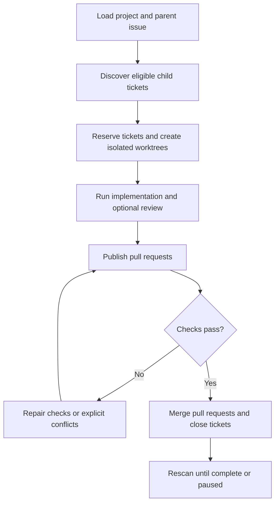

# Sandcastle Runner

Sandcastle Runner is a local CLI that uses code to manage the routine steps of
delivering GitHub tickets. It selects eligible tickets, prepares isolated
worktrees, verifies and pushes commits, publishes pull requests, waits for CI,
and coordinates merges and ticket closure.

This keeps AI agents focused on writing, reviewing, and repairing code while
reducing unnecessary token use for workflow coordination. Runner invokes agents
through Sandcastle when a task needs code changes or review.

## Workflow



## Prerequisites

Install these on the host that runs Runner:

- Node.js 22.18.0 or newer, including its bundled npm.
- Git, with `git` on `PATH`; Runner requires worktree support.
- GitHub CLI (`gh`), with `gh` on `PATH`.
- An installed and authenticated coding-agent CLI for every configured agent,
  directly runnable on `PATH`.
- A GitHub repository checkout at an absolute path.

Runner uses Sandcastle's native agent factories and supports `codex`,
`claude-code`, and `pi` profiles. Prepare each selected agent's own sign-in,
skills, MCP servers, and native configuration. Runner does not install or
normalize them.

Keep the Runner checkout, project checkout, worktrees, state, logs, temporary
files, and agent session state on paths without Chinese characters.

## Installation

Runner is a checkout-only CLI and is not published to a package registry:

```sh
git clone https://github.com/xiakeng/sandcastle-runner.git
cd sandcastle-runner
npm ci
```

## Windows Setup

Install Node.js, Git, `gh`, and each selected agent CLI. Reopen PowerShell after
installation so `PATH` changes take effect, then verify:

```powershell
node --version       # v22.18.0 or newer
npm --version
git --version
gh --version
codex --version      # replace with the agent CLI you configured
```

Sandcastle's default session lookup reads `HOME` from the process that starts
Runner. Windows may provide only `USERPROFILE`, so configure `HOME` once at the
user level:

```powershell
[Environment]::SetEnvironmentVariable('HOME', $env:USERPROFILE, 'User')
$env:HOME = [Environment]::GetEnvironmentVariable('HOME', 'User')
node -p "process.env.HOME"
```

For a nonstandard storage location, set the explicit native `options.sessionStorage`
lookup root instead:

```yaml
options:
  sessionStorage:
    hostSessionsDir: 'C:\work\agent-sessions\sessions'
```

Codex and Pi use `hostSessionsDir`; Claude Code uses `hostProjectsDir`. These
options select where sessions are looked up and do not relocate agent storage.

Set the credential variables named by `tracker.tokenEnv` and
`codeHost.tokenEnv` in `config.yaml`; the templates use `GH_TOKEN`. As with
`HOME`, configure it once at the user level:

```powershell
[Environment]::SetEnvironmentVariable('GH_TOKEN', 'your-github-token', 'User')
$env:GH_TOKEN = [Environment]::GetEnvironmentVariable('GH_TOKEN', 'User')
node -p "Boolean(process.env.GH_TOKEN)"
```

## macOS and Linux Setup

Install Node.js, Git, `gh`, and each selected agent CLI, then verify the
commands in the shell that will run Runner:

```sh
node --version       # v22.18.0 or newer
npm --version
git --version
gh --version
codex --version      # replace with the agent CLI you configured
export GH_TOKEN='your-github-token'
```

Use a shell profile or another local secret mechanism when appropriate. Never
commit a token.

## Configuration

Create a project directory under `projects/`:

```text
projects/<project-key>/
  config.yaml
  prompts/
    implement.md
    review.md
    ci-repair.md
    conflict-repair.md
    documentation.md
  logs/
```

Start from `projects/sandcastle-runner/config.yaml` and configure the
repository, absolute checkout, target branch, credential variable names,
timeouts, workflow flags, and agent profiles.

Each `agents.<purpose>` profile requires `agent` and `model`, and accepts an
optional native `options` object:

```yaml
agents:
  implement:
    agent: codex
    model: gpt-6-sol
    options:
      effort: max
  review:
    agent: claude-code
    model: claude-opus-4-8
    options:
      effort: high
  ciRepair:
    agent: pi
    model: claude-sonnet-4-6
    options:
      thinking: high
  conflictRepair:
    agent: codex
    model: gpt-6-sol
    options:
      effort: medium
  documentation:
    agent: claude-code
    model: claude-opus-4-8
    options:
      effort: high
workflow:
  review: true
  docMaintainTriggerLabel: doc-check
```

The five purpose keys are `implement`, `review`, `ciRepair`, `conflictRepair`,
and `documentation`. `review` is required when review is enabled;
`documentation` is required for Documentation Maintenance. Agent, model, and
purpose are independent: Runner forwards the model and nested native options
unchanged and never infers the agent from the model.

Enabled workflow nodes require their prompt file. Implementation, CI repair,
and conflict repair prompts must be non-empty.

## Run

```sh
npm exec -- sandcastle-runner run --project <project-key> --parent <issue-number>
npm exec -- sandcastle-runner run --project <project-key> --issue <issue-number>
npm exec -- sandcastle-runner run --project <project-key> --issue
npm exec -- sandcastle-runner run --project <project-key> --document
```

`--issue` without a number uses the project's configured `issueList`.
`--document` runs standalone Documentation Maintenance.

Standalone runs request a merge after their pull request is CI-ready. Use
`--no-auto-merge` with a value-bearing `--issue` to leave the pull request open
after validation and cleanup.

Runner prints the outcome of each Delivery and Maintenance Ticket, remaining
discovery reasons, retained worktrees, and the Audit Log path. `succeeded` and
`no_work` exit successfully; `incomplete`, `cancelled`, and `failed` do not.

## Verification and Development

```sh
npm test                 # full test suite
npm run typecheck        # TypeScript diagnostics
npm run check            # formatting, lint, and typecheck
npm run verify           # tests plus all checks
npm run format           # format source files
```

The test suite uses scripted adapters and harmless local processes. It does not
call authenticated agents or mutate a remote GitHub repository.

## Acknowledgements

Thanks to [Sandcastle](https://github.com/mattpocock/sandcastle) and its
contributors for the agent orchestration library that Runner depends on.
Runner uses Sandcastle's native agent factories to run coding agents.
