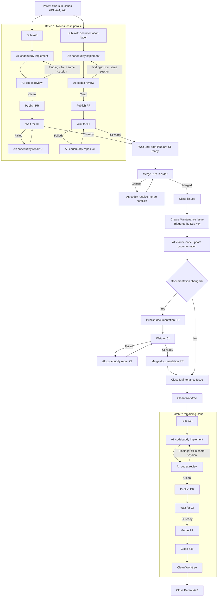

[English](README.md) | [简体中文](README.zh-CN.md)

# Sandcastle Runner

Sandcastle Runner 是一个本地 CLI，用代码管理交付 GitHub ticket 的常规步骤。它选择符合条件的 ticket，准备隔离的 Worktree，校验并推送 commit，发布 pull request，等待 CI，并协调 merge 与 ticket 关闭。

Runner 可在 Windows、macOS 和 Linux 上运行，支持 `codex`、`claude-code`、`pi` 和 `codebuddy`。

npm 包和可执行文件都名为 `issue-runner`。详细的安装配置与工作流说明见[配置与工作流指南](docs/config-guide.zh-CN.md)。

## 它能做什么？
<details>
<summary>展开 Parent Run 工作流</summary>

这个成功的 Run 使用 `maxBatchSize: 2` 和 `workflow.docMaintainTriggerLabel: documentation` 处理三个符合条件的 sub-issue。Sub-issue #44 带有 `documentation` label。`AI:` 标记 coding-agent 的工作。

```sh
issue-runner run --project my-project --parent 42
```



</details>

让 AI agent 专注于编写、评审和修复代码，同时减少工作流协调带来的不必要 token 消耗。Runner 通过 [Sandcastle](https://github.com/mattpocock/sandcastle) 调用 agent

## 前置条件

npm 包只提供 Runner。请在运行它的主机上安装以下内容：

- Node.js 22.x 系列中 22.18.0 或更高版本，包括 npm。
- Git，且 `git` 在 `PATH` 上；Runner 需要 Worktree 支持。
- GitHub CLI（`gh`），且 `gh` 在 `PATH` 上。
- 为每个已配置的 agent 安装并完成认证的 coding-agent CLI，可直接在 `PATH` 上运行。
- 原生 agent 权限设置，允许所需操作而无需交互式 CLI 审批提示。
- 位于绝对路径的 GitHub 仓库 checkout。

请自行准备每个所选 agent 的登录、skills、MCP server 和原生配置。Runner 不会安装或规范化它们。

在启动 Runner 之前完成认证与权限设置。Operator Pause 会在 Agent Attempt 停止后接受恢复指令。超时暂停会让原始调用保持存活。对话文本无法回答原生审批请求，也无法授予被拒绝的权限。

请将 Project checkout、Worktree、状态、日志、临时文件和 agent 会话状态放在不含中文字符的路径上。

## 安装

使用 `npx` 运行最新版本：
```sh
npx issue-runner@latest --help
```

或全局安装：
```sh
npm install -g issue-runner@latest
issue-runner --help
```

## 初始化 Project

在应当包含该 Project 的目录中运行初始化。启动目录是 Runner 唯一查找的位置：

```sh
cd /work/my-projects
npx issue-runner@latest init --project my-project
```

这会精确创建：

```text
my-project/
  config.yaml
  prompts/
    implement.md
    review.md
    documentation.md
```

### 编辑占位符

替换 `my-project/config.yaml` 中的每个占位符：

- `repository`：目标 GitHub 仓库，格式为 `owner/repository`。
- `checkout`：该仓库 checkout 的绝对路径。在 Windows 上使用类似 `C:\work\your-repository` 的路径。
- `targetBranch`：要集成到的分支；省略则使用仓库默认分支。
- `tracker.runnerAccount`：拥有 Reservation 的 GitHub 账户。
- 每个 `agents.*.model`：你的已配置 agent 接受的模型名称。
- 当你使用其他受支持的 agent CLI 时，设置每个 `agents.*.agent`。
- 当模板值不适合该项目时，调整 `agentMinutes`、重试延迟和其他限制。
- 当 Review 或 Documentation Maintenance 使用不同的 ticket 模板时，设置 `maintenanceTicket`。

设置 `tracker.tokenEnv` 和 `codeHost.tokenEnv` 指定的环境变量；模板使用 `GH_TOKEN`。

使用你的仓库的实现、评审和文档说明编辑这三个 prompt 文件。

## 运行

```sh
issue-runner run --project my-project --parent 42                # Deliver the child issues of #42.
issue-runner run --project my-project --issue 43                 # Deliver single issue #42.
issue-runner run --project my-project --issue                    # Deliver the issues list configured in config.yaml.
issue-runner run --project my-project --document                 # only start document maintain job
issue-runner run --project my-project --issue 43 --no-auto-merge # Keep the PR and Worktree for manual review.
issue-runner run --project my-project --document --no-auto-merge # Keep the documentation PR and Worktree if changes exist.
```

## 帮助与版本

```sh
issue-runner --help
issue-runner -h
issue-runner run --help
issue-runner run -h
issue-runner init --help
issue-runner --version
```

两个帮助入口都接受长格式和短格式。信息类输出会在必需参数、Project、凭据或外部工具校验之前成功返回，并且不写入文件，也不会启动 Run。`--version` 读取正在执行的包自身的元数据，因此对同一产物，直接执行和 `npx` 执行的结果一致。

## Windows 设置

安装 Node.js、Git、`gh` 以及每个所选 agent CLI。安装后重新打开 PowerShell，使 `PATH` 变更生效，然后验证：

```powershell
node --version       # v22.18.0 or newer
npm --version
git --version
gh --version
codex --version      # replace with the agent CLI you configured
```

Sandcastle 默认的会话查找会从启动 Runner 的进程读取 `HOME`。Windows 可能只提供 `USERPROFILE`，因此请在用户级别配置一次 `HOME`：

```powershell
[Environment]::SetEnvironmentVariable('HOME', $env:USERPROFILE, 'User')
$env:HOME = [Environment]::GetEnvironmentVariable('HOME', 'User')
node -p "process.env.HOME"
```

对于非标准存储位置，改为设置显式的原生 `options.sessionStorage` 查找根目录：

```yaml
options:
  sessionStorage:
    hostSessionsDir: 'C:\work\agent-sessions\sessions'
```

Codex 和 Pi 使用 `hostSessionsDir`；Claude Code 使用 `hostProjectsDir`。这些选项只选择会话查找的位置，不会迁移 agent 存储。

设置 `config.yaml` 中 `tracker.tokenEnv` 和 `codeHost.tokenEnv` 指定的凭据变量；模板使用 `GH_TOKEN`。与 `HOME` 一样，请在用户级别配置一次：

```powershell
[Environment]::SetEnvironmentVariable('GH_TOKEN', 'your-github-token', 'User')
$env:GH_TOKEN = [Environment]::GetEnvironmentVariable('GH_TOKEN', 'User')
node -p "Boolean(process.env.GH_TOKEN)"
```

## macOS 和 Linux 设置

安装 Node.js、Git、`gh` 以及每个所选 agent CLI，然后在将运行 Runner 的 shell 中验证这些命令：

```sh
node --version       # v22.18.0 or newer
npm --version
git --version
gh --version
codex --version      # replace with the agent CLI you configured
export GH_TOKEN='your-github-token'
```

在合适时使用 shell profile 或其他本地密钥机制。切勿提交 token。

## 验证与开发

```sh
npm test                 # full test suite, including packaged-tarball acceptance
npm run typecheck        # TypeScript diagnostics
npm run check            # formatting, lint, and typecheck
npm run build            # compile ESM JavaScript into dist/
npm run release:accept   # accept a packed tarball (RELEASE_TARBALL=<path>)
npm run verify           # tests plus all checks
npm run format           # format source files
```

测试套件使用脚本化 adapter 和无害的本地进程。它不会调用已认证的 agent，也不会修改远程 GitHub 仓库。打包测试会构建并打包真实产物，将其安装到临时前缀，并从无关目录运行 npm 可执行文件 shim。

## 致谢

感谢 [Sandcastle](https://github.com/mattpocock/sandcastle) 及其贡献者提供 Runner 所依赖的 agent 编排库。Runner 使用 Sandcastle 的原生 agent factory 来运行 coding agent。
