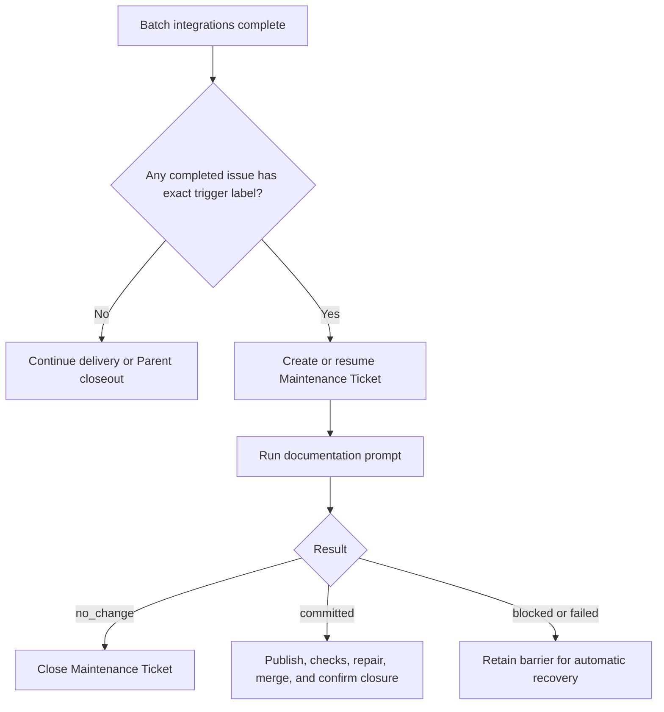
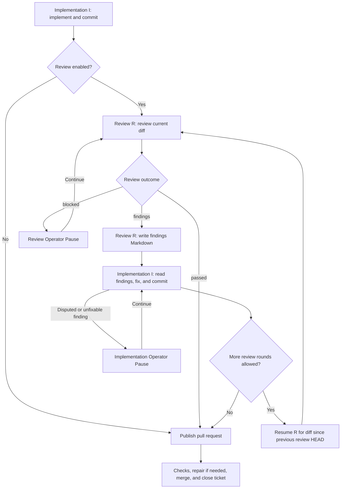

# Configuration and workflow guide

A Project is one child of the directory you launch Runner from. It holds
`config.yaml`, the three Project prompts, and that Project's logs, Recovery
Snapshots, and Worktrees.

## Create a Project

From any directory, initialize a child Project with the published package:

```sh
npx issue-runner@latest init --project <project-key>
```

Initialization copies `config.yaml` and `prompts/{implement,review,documentation}.md`
from reviewed templates. It never overwrites an existing destination and never
uses credentials, the network, or a target checkout.

## Configure a Project

Edit your Project's `config.yaml`; the [template's inline comments](../templates/config.yaml) explain each field. Runner uses GitHub for both issue tracking and pull requests.
The implementation prompt must be nonempty. Review and documentation prompts are required when their workflow is enabled. CI and conflict repairs use fixed Runner-owned input templates; no Project repair prompt is required.

## Run

```sh
issue-runner run --project <project-key> --parent <issue-number>
issue-runner run --project <project-key> --issue <issue-number>
issue-runner run --project <project-key> --issue
issue-runner run --project <project-key> --document
```

`run --project <key>` reads only `cwd/<key>`. A missing or invalid Project is a
startup failure; there is no fallback to another configuration.

`--issue` without a number uses the Project's configured `issueList`.
`--document` runs standalone Documentation Maintenance.

Standalone runs request a merge after their pull request is CI-ready. Use
`--no-auto-merge` with a value-bearing `--issue` to leave the pull request open
after validation and cleanup. `--auto-merge` and `--no-auto-merge` are mutually
exclusive, reject supplied values, and require a value-bearing `--issue`.

Audit logs, agent logs, review findings, Recovery Snapshots, and Worktrees stay
under the selected Project. Runner never writes Run data into the installation
directory, npm's global prefix, or the npx cache.

An Operator Pause gates new Agent steps and delivery advancement across the Run.
Already-started invocations keep collecting output; Runner retains their results
and logs until every pending pause is resolved. Prompts appear one at a time,
and each response applies only to its displayed invocation. Enter, recovery
instructions, and skip keep their context-specific meanings. `q` or EOF cancels
the Run and settles its owned processes. Other Runs continue independently.

Runner prints the outcome of each Delivery and Maintenance Ticket, remaining
discovery reasons, retained worktrees, and the Audit Log path. `succeeded` and
`no_work` exit successfully; `incomplete`, `cancelled`, and `failed` do not.

## Operator Pause actions

When automatic recovery stops or an Agent reaches a timeout threshold, the Runner waits for your input. These terminal examples use illustrative paths and diagnostics; `[Enter]` means press Enter without typing text.

### Agent timeout thresholds

Reaching `timeouts.agentIdleMinutes` (default: 10) or `timeouts.agentMinutes` opens a pause while the Agent keeps running. Press Enter to keep waiting:

```text
Agent idle threshold reached for implement issue 247. Working directory: /runner/worktrees/ticket-247. Diagnostic log: /runner/logs/implement-247.log. Enter to keep waiting on the same invocation or accept its retained outcome; k to stop only this invocation and remain paused; q/EOF to cancel. Other input is unsupported.
Invocation: implement issue 247. Provider: codex. Native session: session-123. State: running; elapsed 600000 ms; idle threshold 600000 ms; overall threshold 7200000 ms.
> [Enter]
```

### Stop one invocation for manual takeover

Enter `k` at the selected invocation's timeout pause:

```text
> k
Selected CLI and owned descendants settled. Runner remains paused for manual native resume.
Provider: codex
Exact native session: session-123
Working directory: /runner/worktrees/ticket-247
Native transcript: /home/runner/.codex/sessions/2026/10/28/session-123.jsonl
GIT_CONFIG_GLOBAL: /runner/git-config
Diagnostic log: /runner/logs/implement-247.log
Exit the manual CLI before pressing Enter to resume the exact session through Runner. q/EOF cancels the Run. Other input is unsupported.
> [Enter]
```

In another terminal, resume the displayed native session from its working directory using the displayed Git configuration. Exit that CLI before pressing Enter in Runner to continue the same session. Other invocations keep running.

### Continue an Agent session

Use the session, working directory, and diagnostic log to investigate the failure, then enter recovery instructions:

```text
Outcome: blocked
Reason: Required API credentials are missing
Agent: codex
Provider session: session-123
Working directory: /runner/worktrees/ticket-247
Diagnostic log: /runner/logs/implement-247.log
Actions: Enter to continue, s to skip, q to cancel, or provide recovery instructions.
> Credentials are configured. Retry the API request and run the tests.
```

The Runner sends your text to the same session. Pressing Enter sends `continue` instead. JSON input is also recovery text; subsequent results still require normal validation and independent Git verification. These actions apply to implementation, Review, documentation, CI repair, and conflict repair.

### Retry when the Agent session is unavailable

A failed session probe or unusable session offers a fresh attempt:

```text
Outcome: failed
Reason: Agent session is unavailable
Agent: codex
Provider session: unavailable
Working directory: /runner/worktrees/ticket-247
Diagnostic log: /runner/logs/implement-247.log
Actions: Enter to retry, s to skip, q to cancel. Other input is unsupported.
> [Enter]
```

Enter starts a fresh attempt after process settlement. Other text leaves this pause open; `s` skips the current issue, and `q` or EOF cancels the Run.

### Retry or skip an issue operation

After repairing the cause of a failed read or write, press Enter to retry:

```text
Operation failed. Actions: Enter to retry, s to skip Delivery Ticket 247, q/EOF to cancel. Other input is unsupported.
> [Enter]
```

If you choose to stop processing that issue, enter `s` instead:

```text
Operation failed. Actions: Enter to retry, s to skip Delivery Ticket 247, q/EOF to cancel. Other input is unsupported.
> s
```

Other issues continue, and the Run does not select the skipped issue again. Existing PRs, comments, branches, and merges remain. Before publication, the Runner attempts Reservation release; `s` at a failed release abandons it and reports possible residue. Maintenance preparation also permits `s` before its issue exists, skipping that occurrence.

After delivery, `s` skips only the remaining cleanup or release, preserving completed delivery and pending cleanup evidence:

```text
Terminal cleanup for Ticket 247 failed: permission denied Actions: Enter to retry, s to skip remaining cleanup for Ticket 247, q/EOF to cancel. Other input is unsupported.
> s
```

Skipped work and unfinished cleanup make the Run return `incomplete`.

Enter retries reads, creation, label/assignee writes, push, and Worktree creation directly. Creation retries can produce duplicates when an earlier write succeeded without confirmation. Repair partial Worktree state before retrying. Merge retries refresh status and HEAD; already merged or queued work proceeds without another merge request. Check and repair timeouts refresh evidence before waiting or repairing. Closure and publication recovery recheck current state; cleanup retries remaining owned artifacts.

### Retry or cancel a global operation

Startup, discovery, shared Batch fetch, and final Parent closure have no current issue to skip:

```text
Operation failed. Actions: Enter to retry, q/EOF to cancel. Other input is unsupported.
> q
```

Enter retries; `q` or EOF cancels the Run. Other input, including `s` and successful-result JSON, leaves the pause open without retrying or resetting the budget.

### Retry an audit failure

Audit failures permit only retry or cancellation, even while skipping an issue. Enter retries the same log action:

```text
Audit write failed. Enter to retry the same log action, q/EOF to cancel. Other input is unsupported.
> s
Audit write failed. Enter to retry the same log action, q/EOF to cancel. Other input is unsupported.
> [Enter]
```

The Runner does not replay the business action that already completed. Enter `q` or send EOF to cancel. Input cannot accept an audit gap, acknowledge a successful write, or mark cleanup complete.

## Documentation Maintenance workflow

At the normal post-Batch scheduling point, one automatic occurrence is required when at least one successfully delivered issue had the configured `workflow.docMaintainTriggerLabel` when its merged, completed closure was confirmed. Multiple matches in the same Batch still schedule one occurrence. Parent labels, delivery counts, Parent closeout, failed Batches, cancellation, and CI-ready unmerged Pull Requests do not trigger maintenance.



Delivery-time labels are stored in the Recovery Snapshot. On restart, the current `config.yaml` trigger is evaluated against that stored evidence. An empty or newly nonmatching trigger stops continuation without closing or deleting the existing Maintenance Ticket, Pull Request, branch, or Worktree; their recorded locations are reported for manual handling.

`--document` runs one fresh, complete occurrence without a Parent or issue scope. It ignores `issueList`, does not require a trigger label, never resumes prior maintenance, and preserves the ordinary no-change behavior without creating an empty Pull Request.

## Review and implementation loop

Runner uses two independent sessions: implementation I writes code and commits; review R inspects Standards and Spec.



The reviewer writes actionable findings under the Project logs directory and returns the assigned path. A clean review needs no findings document.
Both sessions are reused within one Runner process. Each review receives the issue reference, Worktree, branch, diff boundaries, and findings path through `review-attempt-input.md`. The reviewer reads the issue and repository instructions itself. Subsequent reviews inspect only the latest fix and verify earlier findings were resolved.
At the configured limit, implementation still fixes the final findings before publication, without another review. See `workflow.maxReviewRounds` in [config.yaml](../templates/config.yaml) for counting and limits.

Findings and session logs remain available throughout the loop. Completion or skip cleans owned files; pause and cancellation retain them.

## Project prompts

Keep only repository-specific instructions in these files:

- `implement.md`: implementation practices and checks
- `review.md`: review skills and criteria
- `documentation.md`: documentation scope and conventions

Runner-owned templates supply task context, Worktree and branch restrictions, review diff boundaries, findings paths, and output protocols.
Project prompts do not need placeholders for these inputs.
