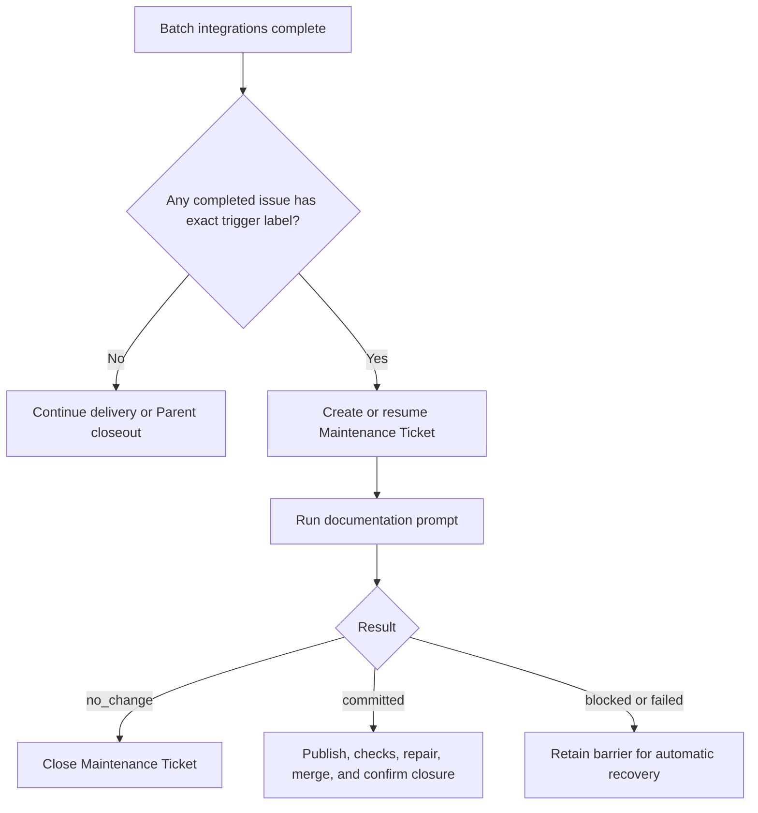
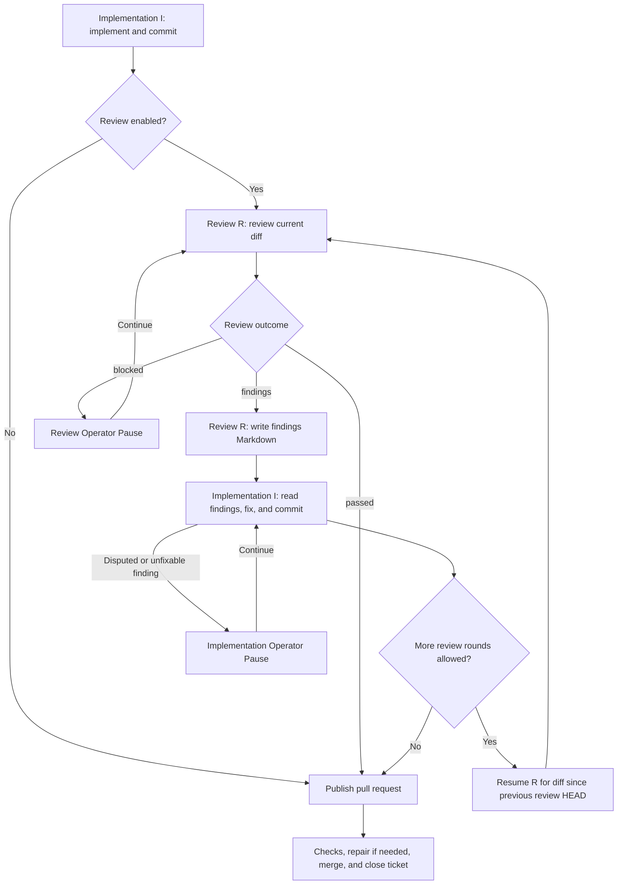

[English](config-guide.md) | [简体中文](config-guide.zh-CN.md)

# 配置与工作流指南

Project 是你启动 Runner 的目录下的一个子目录。它包含 `config.yaml`、三个 Project prompt，以及该 Project 的日志、Recovery Snapshot 和 Worktree。

## 创建 Project

在任意目录中，使用已发布的包初始化一个子 Project：

```sh
npx issue-runner@latest init --project <project-key>
```

初始化会从经过评审的模板复制 `config.yaml` 和 `prompts/{implement,review,documentation}.md`。它从不覆盖已存在的目标，也从不使用凭据、网络或目标 checkout。

## 配置 Project

编辑你的 Project 的 `config.yaml`；[模板的行内注释](../templates/config.yaml)解释了每个字段。Runner 同时使用 GitHub 进行 issue 跟踪和 pull request 管理。
实现 prompt 必须非空。当其工作流启用时，review 和 documentation prompt 是必需的。CI 与冲突修复使用 Runner 固定的输入模板；不需要 Project 提供修复 prompt。

## 运行

```sh
issue-runner run --project <project-key> --parent <issue-number>
issue-runner run --project <project-key> --issue <issue-number>
issue-runner run --project <project-key> --issue
issue-runner run --project <project-key> --document
```

`run --project <key>` 只读取 `cwd/<key>`。Project 缺失或无效属于启动失败；不会回退到其他配置。

不带编号的 `--issue` 使用 Project 配置的 `issueList`。
`--document` 运行独立的 Documentation Maintenance。

Run 默认在 CI 通过后合并其 pull request。对于带编号的 `--issue` 或 `--document`，添加 `--no-auto-merge` 可让 PR 保持打开，并保留其 Worktree 和本地分支。如果 Documentation Maintenance 没有产生改动，Runner 会关闭其 issue 并清理 Worktree，而不创建 PR。

`--auto-merge` 与 `--no-auto-merge` 互斥且不接受值。这两个标志都不能与 `--parent` 或不带值的 `--issue` 一起使用。

审计日志、agent 日志、review findings、Recovery Snapshot 和 Worktree 都保留在所选 Project 下。

## Operator Pause 操作

当自动恢复停止或 Agent 达到超时阈值时，Runner 会等待你的输入。
这些终端示例使用示意性路径和诊断信息；`[Enter]` 表示不输入文本直接按 Enter。

### Agent 超时阈值

达到 `timeouts.agentIdleMinutes`（默认值：10）或 `timeouts.agentMinutes` 时会打开一个暂停，同时 Agent 继续运行。按 Enter 继续等待：

```text
Agent idle threshold reached for implement issue 247. Working directory: /runner/worktrees/ticket-247. Diagnostic log: /runner/logs/implement-247.log. Enter to keep waiting on the same invocation or accept its retained outcome; k to stop only this invocation and remain paused; q/EOF to cancel. Other input is unsupported.
Invocation: implement issue 247. Provider: codex. Native session: session-123. State: running; elapsed 600000 ms; idle threshold 600000 ms; overall threshold 7200000 ms.
> [Enter]
```

### 停止单个调用以进行手动接管

在所选调用的超时暂停处输入 `k`：

```text
> k
Selected CLI and owned descendants settled. Runner remains paused for manual native resume.
Provider: codex
Exact native session: session-123
Working directory: /runner/worktrees/ticket-247
Native transcript: /home/runner/.codex/sessions/2026/10/28/session-123.jsonl
GIT_CONFIG_GLOBAL: /runner/git-config
Diagnostic log: /runner/logs/implement-247.log
Exit the manual CLI before pressing Enter to resume the exact session through Runner. q/EOF cancels the Run. Other input is unsupported.
> [Enter]
```

在另一个终端中，从显示的工作目录使用显示的 Git 配置恢复所显示的原生会话。退出该 CLI 后，在 Runner 中按 Enter 以继续同一会话。其他调用会继续运行。

### 继续 Agent 会话

使用会话、工作目录和诊断日志排查失败，然后输入恢复指令：

```text
Outcome: blocked
Reason: Required API credentials are missing
Agent: codex
Provider session: session-123
Working directory: /runner/worktrees/ticket-247
Diagnostic log: /runner/logs/implement-247.log
Actions: Enter to continue, s to skip, q to cancel, or provide recovery instructions.
> Credentials are configured. Retry the API request and run the tests.
```

Runner 会将你的文本发送到同一会话。按 Enter 则会发送 `continue`。JSON 输入同样是恢复文本；后续结果仍需正常校验和独立的 Git 验证。这些操作适用于 implementation、Review、documentation、CI 修复和冲突修复。

### Agent 会话不可用时重试

会话探测失败或会话不可用时会提供一次全新尝试：

```text
Outcome: failed
Reason: Agent session is unavailable
Agent: codex
Provider session: unavailable
Working directory: /runner/worktrees/ticket-247
Diagnostic log: /runner/logs/implement-247.log
Actions: Enter to retry, s to skip, q to cancel. Other input is unsupported.
> [Enter]
```

按 Enter 会在进程结算后开始一次全新尝试。其他文本会让此暂停保持打开；`s` 跳过当前 issue，`q` 或 EOF 取消 Run。

### 重试或跳过 issue 操作

在修复读取或写入失败的原因后，按 Enter 重试：

```text
Operation failed. Actions: Enter to retry, s to skip Delivery Ticket 247, q/EOF to cancel. Other input is unsupported.
> [Enter]
```

如果你选择停止处理该 issue，改为输入 `s`：

```text
Operation failed. Actions: Enter to retry, s to skip Delivery Ticket 247, q/EOF to cancel. Other input is unsupported.
> s
```

其他 issue 会继续处理，Run 不会再次选择被跳过的 issue。已有的 PR、评论、分支和 merge 会保留。在发布之前，Runner 会尝试释放 Reservation；在释放失败时选择 `s` 会放弃释放并报告可能的残留。Maintenance 准备阶段在其 issue 尚不存在时也允许 `s`，从而跳过该次维护。

交付之后，`s` 只跳过剩余的清理或释放，保留已完成的交付和待清理的证据：

```text
Terminal cleanup for Ticket 247 failed: permission denied Actions: Enter to retry, s to skip remaining cleanup for Ticket 247, q/EOF to cancel. Other input is unsupported.
> s
```

被跳过的工作和未完成的清理会使 Run 返回 `incomplete`。

按 Enter 会直接重试读取、创建、label/assignee 写入、push 和 Worktree 创建。当前一次写入已成功但未确认时，创建重试可能产生重复项。重试前请修复不完整的 Worktree 状态。Merge 重试会刷新状态和 HEAD；已 merge 或已排队的工作会继续，不会再次发出 merge 请求。检查与修复超时会在等待或修复前刷新证据。关闭与发布恢复会重新检查当前状态；清理会重试剩余的归属产物。

### 重试或取消全局操作

启动、发现、共享 Batch 获取和最终 Parent 关闭都没有可供跳过的当前 issue：

```text
Operation failed. Actions: Enter to retry, q/EOF to cancel. Other input is unsupported.
> q
```

按 Enter 重试；`q` 或 EOF 取消 Run。其他输入，包括 `s` 和成功结果 JSON，会让暂停保持打开，既不会重试也不会重置预算。

### 重试审计失败

审计失败只允许重试或取消，即使正处于跳过某个 issue 的过程中也是如此。按 Enter 重试同一个日志操作：

```text
Audit write failed. Enter to retry the same log action, q/EOF to cancel. Other input is unsupported.
> s
Audit write failed. Enter to retry the same log action, q/EOF to cancel. Other input is unsupported.
> [Enter]
```

Runner 不会重放已经完成的业务操作。输入 `q` 或发送 EOF 以取消。输入无法接受审计缺口、确认写入成功或将清理标记为完成。

## Documentation Maintenance 工作流

在正常的 Batch 后调度点，只要有至少一个成功交付的 issue 在确认已 merge 且以 completed 关闭时带有配置的 `workflow.docMaintainTriggerLabel`，就需要执行一次自动维护。同一 Batch 中的多个匹配仍只调度一次维护。Parent 的 label、交付数量、Parent 关闭、失败的 Batch、取消以及已 CI-ready 但未 merge 的 Pull Request 都不会触发维护。



交付时的 label 存储在 Recovery Snapshot 中。重启时，会用当前的 `config.yaml` 触发条件与已存储的证据进行比对。触发条件为空或新条件不再匹配时，会停止继续，但不会关闭或删除现有的 Maintenance Ticket、Pull Request、分支或 Worktree；它们记录的位置会报告出来供手动处理。

`--document` 运行一次全新的完整维护，没有 Parent 或 issue 范围。它忽略 `issueList`，不要求触发 label，从不恢复此前的维护，并保留常规的 no-change 行为，不创建空的 Pull Request。

## Review 与实现循环

Runner 使用两个独立会话：implementation I 编写代码并提交；review R 检查 Standards 和 Spec。



评审者会将可操作的 findings 写入 Project 日志目录，并返回指定的路径。干净的评审不需要 findings 文档。
两个会话都在同一个 Runner 进程内复用。每次评审都会通过 `review-attempt-input.md` 收到 issue 引用、Worktree、分支、diff 边界和 findings 路径。评审者自行读取 issue 和仓库说明。后续评审只检查最新修复，并验证此前的 findings 已解决。
达到配置上限时，implementation 仍会在发布前修复最终的 findings，而不会进行另一次评审。计数与上限见 [config.yaml](../templates/config.yaml) 中的 `workflow.maxReviewRounds`。

findings 和会话日志在整个循环中保持可用。完成或跳过会清理归属文件；暂停和取消会保留它们。

## Project prompt

这些文件中只保留仓库特定的说明：

- `implement.md`：实现实践与检查
- `review.md`：评审技能与标准
- `documentation.md`：文档范围与约定

Runner 自有的模板提供任务上下文、Worktree 和分支限制、评审 diff 边界、findings 路径以及输出协议。
Project prompt 不需要为这些输入提供占位符。
