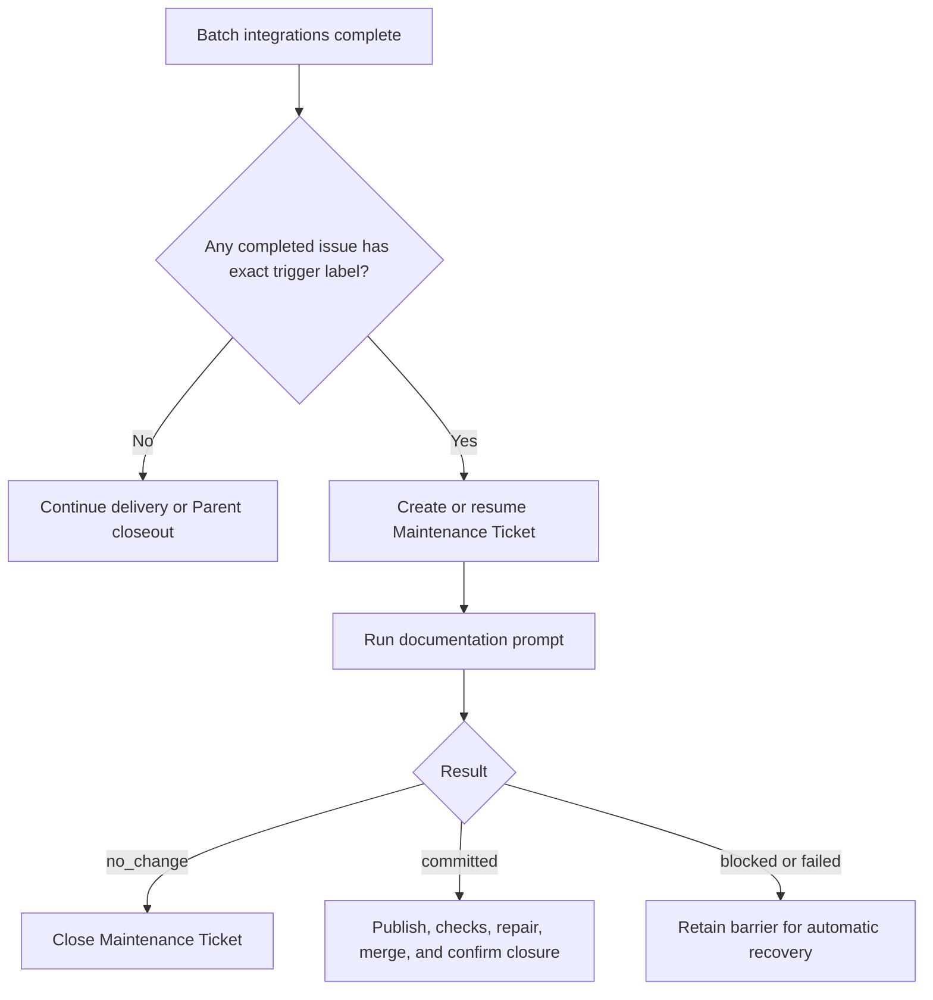
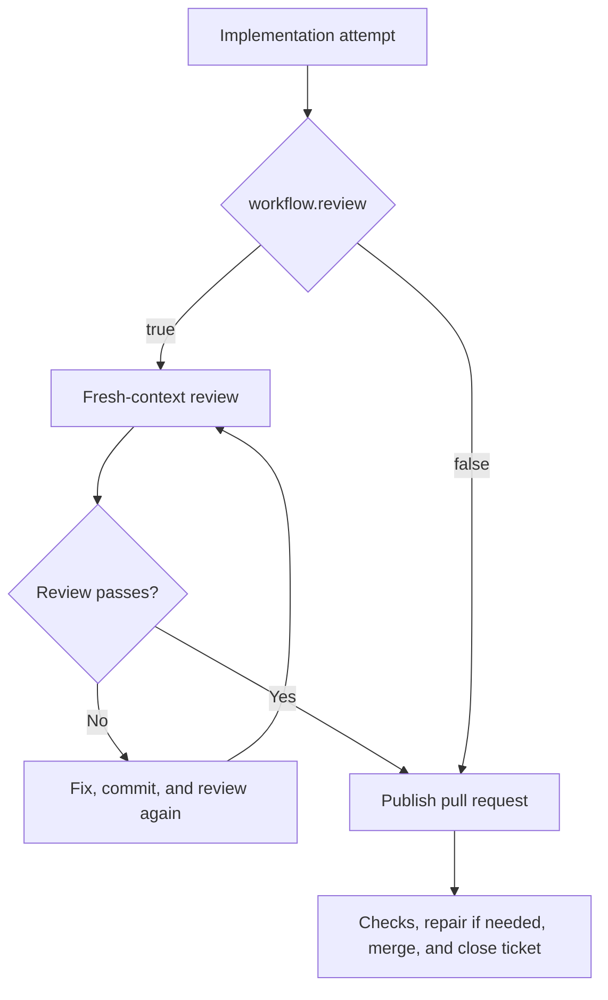

# Project Template

This directory is a project template for Sandcastle Runner. Copy it to `projects/<project-key>` and adapt `config.yaml` and the prompts.

## `config.yaml`

- `repository`: GitHub repository in `owner/name` form.
- `checkout`: absolute path to that repository.
- `issueList`: unique positive issue numbers used to limit Parent Runs or drive value-less Standalone Runs.
- `maxBatchSize`: required positive safe integer limiting newly discovered Parent and Standalone Batches.
- `targetBranch`: branch to update.
- `tracker`: GitHub settings: `tokenEnv` names the credential variable; `runnerAccount` is the bot/user; `reservationLabel` marks reserved tickets.
- `codeHost`: GitHub settings; `tokenEnv` names the credential variable and `adminMerge` controls administrative merge requests.
- `workflow.review`: enable or disable the review attempt.
- `workflow.docMaintainTriggerLabel`: exact, case-sensitive label that triggers automatic Documentation Maintenance after a successful Batch. Omitted, empty, or whitespace-only values disable automatic maintenance.
- `agents`: an `agent`, `model`, and optional native `options` for `implement`, `review`, `ciRepair`, `conflictRepair`, and `documentation` purposes. Each purpose is independent, and the same agent may be reused. `review` is needed when enabled; `documentation` is needed for a nonempty trigger label or `--document`, and both automatic and standalone Documentation Maintenance use it.
- `timeouts`: required positive minute limits for agent attempts, required checks, and merge queue confirmation.
- `operationRetry` and `agentRetry`: non-negative automatic retry counts; the corresponding `*Delay` arrays are positive delays in seconds. Follow [ADR-0001](../docs/adr/0001-configurable-retry-policy.md): counts are additional attempts after the initial one, and the final delay is reused.
- `ticketClosure`: `runner` or `code_host`.
- `maintenanceTicket`: title, body, and `doc-maintain` label for maintenance tickets.

If Sandcastle's default session lookup does not
match the agent's actual storage, set the native lookup root:
`sessionStorage.hostSessionsDir` for Codex or Pi, or
`sessionStorage.hostProjectsDir` for Claude Code.

## Operator Pause actions

When automatic recovery stops, the Runner waits for your input. These terminal examples use illustrative paths and diagnostics; `[Enter]` means press Enter without typing text.

### Continue an Agent session

Use the session, working directory, and diagnostic log to investigate the failure, then enter recovery instructions:

```text
Outcome: blocked
Reason: Required API credentials are missing
Agent: codex
Provider session: session-123
Working directory: /runner/worktrees/ticket-247
Diagnostic log: /runner/logs/implement-247.log
Actions: Enter to continue, s to skip, q to cancel, or provide recovery instructions.
> Credentials are configured. Retry the API request and run the tests.
```

The Runner sends your text to the same session. Pressing Enter sends `continue` instead. JSON input is also recovery text; subsequent results still require normal validation and independent Git verification. These actions apply to implementation, Review, documentation, CI repair, and conflict repair.

### Retry when the Agent session is unavailable

A failed session probe or unusable session offers a fresh attempt:

```text
Outcome: failed
Reason: Agent session is unavailable
Agent: codex
Provider session: unavailable
Working directory: /runner/worktrees/ticket-247
Diagnostic log: /runner/logs/implement-247.log
Actions: Enter to retry, s to skip, q to cancel. Other input is unsupported.
> [Enter]
```

Enter starts a fresh attempt after process settlement. Other text leaves this pause open; `s` skips the current issue, and `q` or EOF cancels the Run.

### Retry or skip an issue operation

After repairing the cause of a failed read or write, press Enter to retry:

```text
Operation failed. Actions: Enter to retry, s to skip Delivery Ticket 247, q/EOF to cancel. Other input is unsupported.
> [Enter]
```

If you choose to stop processing that issue, enter `s` instead:

```text
Operation failed. Actions: Enter to retry, s to skip Delivery Ticket 247, q/EOF to cancel. Other input is unsupported.
> s
```

Other issues continue, and the Run does not select the skipped issue again. Existing PRs, comments, branches, and merges remain. Before publication, the Runner attempts Reservation release; `s` at a failed release abandons it and reports possible residue. Maintenance preparation also permits `s` before its issue exists, skipping that occurrence.

After delivery, `s` skips only the remaining cleanup or release, preserving completed delivery and pending cleanup evidence:

```text
Terminal cleanup for Ticket 247 failed: permission denied Actions: Enter to retry, s to skip remaining cleanup for Ticket 247, q/EOF to cancel. Other input is unsupported.
> s
```

Skipped work and unfinished cleanup make the Run return `incomplete`.

Enter retries reads, creation, label/assignee writes, push, and Worktree creation directly. Creation retries can produce duplicates when an earlier write succeeded without confirmation. Repair partial Worktree state before retrying. Merge retries refresh status and HEAD; already merged or queued work proceeds without another merge request. Check and repair timeouts refresh evidence before waiting or repairing. Closure and publication recovery recheck current state; cleanup retries remaining owned artifacts.

### Retry or cancel a global operation

Startup, discovery, shared Batch fetch, and final Parent closure have no current issue to skip:

```text
Operation failed. Actions: Enter to retry, q/EOF to cancel. Other input is unsupported.
> q
```

Enter retries; `q` or EOF cancels the Run. Other input, including `s` and successful-result JSON, leaves the pause open without retrying or resetting the budget.

### Retry an audit failure

Audit failures permit only retry or cancellation, even while skipping an issue. Enter retries the same log action:

```text
Audit write failed. Enter to retry the same log action, q/EOF to cancel. Other input is unsupported.
> s
Audit write failed. Enter to retry the same log action, q/EOF to cancel. Other input is unsupported.
> [Enter]
```

The Runner does not replay the business action that already completed. Enter `q` or send EOF to cancel. Input cannot accept an audit gap, acknowledge a successful write, or mark cleanup complete.

## Documentation Maintenance workflow

At the normal post-Batch scheduling point, one automatic occurrence is required when at least one successfully delivered issue had the configured `workflow.docMaintainTriggerLabel` when its merged, completed closure was confirmed. Multiple matches in the same Batch still schedule one occurrence. Parent labels, delivery counts, Parent closeout, failed Batches, cancellation, and CI-ready unmerged Pull Requests do not trigger maintenance.



Delivery-time labels are stored in the Recovery Snapshot. On restart, the current `config.yaml` trigger is evaluated against that stored evidence. An empty or newly nonmatching trigger stops continuation without closing or deleting the existing Maintenance Ticket, Pull Request, branch, or Worktree; their recorded locations are reported for manual handling.

`--document` runs one fresh, complete occurrence without a Parent or issue scope. It ignores `issueList`, does not require a trigger label, never resumes prior maintenance, and preserves the ordinary no-change behavior without creating an empty Pull Request.

## Review enabled versus disabled



## Prompt placeholders

- `implement.md`: `TICKET_NUMBER` (issue number), `TICKET_REFERENCE` (authoritative issue reference), `WORKTREE_PATH` (isolated worktree), `SOURCE_BRANCH` (delivery branch), `BASE_SHA` (worktree base commit), `PROJECT_TARGET_BRANCH` (configured target branch).
- `ci-repair.md`: the implementation fields above, plus `PULL_REQUEST_NUMBER` and `PULL_REQUEST_URL` (existing pull request), and `FAILED_CHECKS` (failed required checks and links).
- `conflict-repair.md`: the same ticket, worktree, branch, and base fields, plus `PULL_REQUEST_NUMBER`, `PULL_REQUEST_URL`, `TARGET_BRANCH_SHA` (fresh target branch commit), and `MERGE_CONFLICT` (reported conflict details).
- `documentation.md`: `TICKET_NUMBER`, `TICKET_REFERENCE`, `WORKTREE_PATH`, `SOURCE_BRANCH`, and `PROJECT_TARGET_BRANCH`.
- `review.md`: `REVIEW_HANDOFF`, a JSON review context containing repository, branches, worktree, fixed point, ticket/spec snapshots, instructions, and reported checks.
