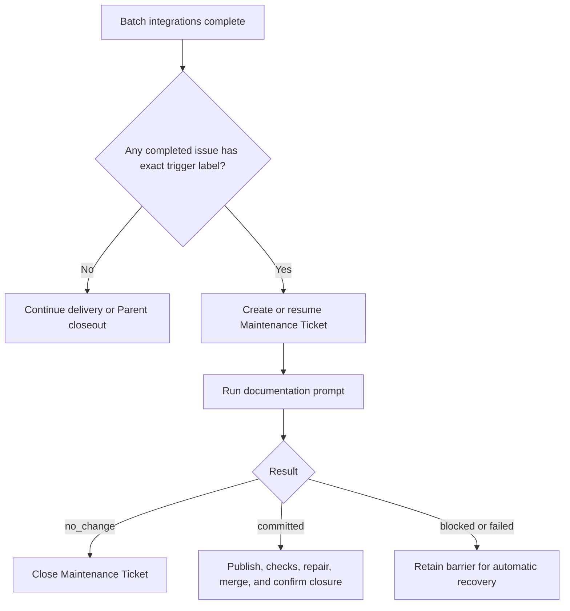
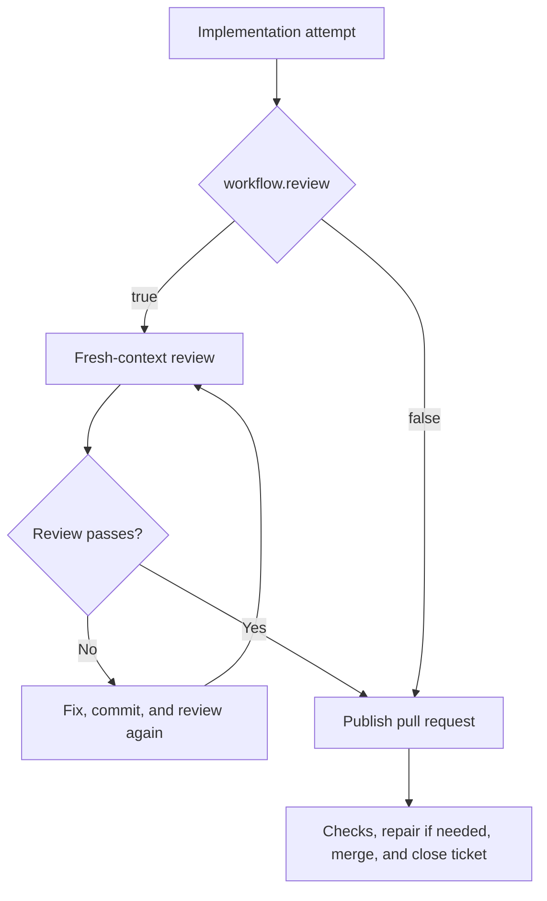

# Project Template

This directory is a project template for Sandcastle Runner. Copy it to `projects/<project-key>` and adapt `config.yaml` and the prompts.

## Checkout installation contract

The Runner is used from a checkout only. Follow the root [installation
contract](../README.md#installation-contract), including the native
[macOS](../README.md#macos), [Windows](../README.md#windows-native-powershell),
and [Linux](../README.md#linux) prerequisite, `PATH`, and credential
guidance. From the repository root, run:

```sh
npm ci
npm exec -- sandcastle-runner run --project <project-key> (--parent <issue-number> | --issue [<issue-number>] | --document) [--auto-merge | --no-auto-merge]
```

The root contract requires Node.js **>=22.18.0** with its bundled npm, Git,
GitHub CLI (`gh`), an installed and authenticated CLI for each configured
agent, and an absolute checkout path. Keep all executables on `PATH` in the
terminal that invokes the Runner. Runner supports the native Sandcastle
`codex`, `claude-code`, and `pi` agents; it does not support OpenCode, Cursor,
or Copilot. Prepare each selected agent's own skills, MCP servers, and native
configuration; Runner does not install or normalize those environments, and it
defines no universal agent CLI version floor or broader OS support guarantee.
An unknown agent name still fails through ordinary configuration or execution
error handling.

Set the environment variable named by both `tracker.tokenEnv` and
`codeHost.tokenEnv` in this template's `config.yaml` before invoking the Runner:

```sh
export GH_TOKEN='your-github-token'       # macOS/Linux
```

```powershell
$env:GH_TOKEN = 'your-github-token'       # Windows PowerShell
```

The token must be present in the process environment; never commit it. The
Runner uses non-interactive GitHub operations, so interactive `gh auth login` is
not used. Missing tools fail on first use through the existing logical-command
error path. Registry/global/remote-`npx` installation, a native Runner
installer, bundled prerequisites, broader OS/tool-version guarantees, and
WSL-specific behavior are unsupported; see the root contract for details.

## `config.yaml`

- `repository`: GitHub repository in `owner/name` form.
- `checkout`: absolute path to that repository.
- `issueList`: unique positive issue numbers used to limit Parent Runs or drive value-less Standalone Runs.
- `maxBatchSize`: required positive safe integer limiting newly discovered Parent and Standalone Batches.
- `targetBranch`: branch to update.
- `tracker`: GitHub settings: `tokenEnv` names the credential variable; `runnerAccount` is the bot/user; `reservationLabel` marks reserved tickets.
- `codeHost`: GitHub settings; `tokenEnv` names the credential variable and `adminMerge` controls administrative merge requests.
- `workflow.review`: enable or disable the review attempt.
- `workflow.docMaintainTriggerLabel`: exact, case-sensitive label that triggers automatic Documentation Maintenance after a successful Batch. Omitted, empty, or whitespace-only values disable automatic maintenance.
- `agents`: an `agent`, `model`, and optional native `options` for `implement`, `review`, `ciRepair`, `conflictRepair`, and `documentation` purposes. Each purpose is independent, and the same agent may be reused. `review` is needed when enabled; `documentation` is needed for a nonempty trigger label or `--document`, and both automatic and standalone Documentation Maintenance use it.
- `timeouts`: required positive minute limits for agent attempts, required checks, and merge queue confirmation.
- `operationRetry` and `agentRetry`: non-negative automatic retry counts; the corresponding `*Delay` arrays are positive delays in seconds. Follow [ADR-0001](../docs/adr/0001-configurable-retry-policy.md): counts are additional attempts after the initial one, and the final delay is reused.
- `ticketClosure`: `runner` or `code_host`.
- `maintenanceTicket`: title, body, and `doc-maintain` label for maintenance tickets.

Keep credentials in the environment, for example `export GH_TOKEN=...`. `workflow.review` defaults to `true`; `workflow.docMaintainTriggerLabel` defaults to an empty string. Use YAML `#` comments for explanations; the loader ignores them.

Each configured agent profile selects one supported native Sandcastle factory
and forwards `options` to it unchanged. `agent`, `model`, and the profile key
are distinct: the model string never selects the agent, and the profile key
selects the workflow purpose. Codex and Claude Code accept native `effort`; Pi
accepts native `thinking`. Native options are agent-specific, so switching
agents does not translate them or promise that the previous options remain
valid.

There is no default agent or model. A profile must name both explicitly. Migrate
an older profile by adding `agent: codex`, preserving its `model` verbatim, and
moving `reasoningEffort` verbatim to `options.effort`, including a value such as
`max`. The obsolete field is rejected even when the new fields are present;
Runner does not backfill or convert it.

Each Agent Attempt probes a `SESSION_READY` session with the purpose's profile,
then resumes that same session through Sandcastle for the substantive work.
Runner does not read `CODEX_HOME` or infer a lookup root for the selected agent
from the OS home directory. If Sandcastle's default session lookup does not
match the agent's actual storage, set the native lookup root:
`sessionStorage.hostSessionsDir` for Codex or Pi, or
`sessionStorage.hostProjectsDir` for Claude Code. This selects where sessions
are looked up and does not relocate the agent's storage. Whether an override is
needed depends on whether the default matches actual storage, not solely on the
operating system. The former automatic Codex directory discovery is removed.

Native run names identify Agent Attempt tasks in log output, but do not title
the agent application's session list. Runner intentionally does not guarantee
application-session titles. When automatic recovery stops, Operator Pause shows
the selected agent, the session ID when available, the working directory, the
diagnostic log, and the permitted Runner actions. The log path is shown even
when a session ID is available. It does not print a copyable manual resume
command; take over with the selected agent's own recovery interface using that
evidence.

Ordinary Sandcastle invocation failures are handled generically, without
agent-name or provider-error-text classification. Successful process settlement
precedes every automatic probe retry, same-session continuation, missing-output
recovery, or structured-output correction. A missing or unusable session enters
manual handling rather than a fresh conversation. Authentication and
configuration errors can consume the bounded Agent Retry budget before pausing,
and native structured-output retries do not cover every invocation failure.
Cancellation stops automatic work after settlement, while a substantive
timeout pauses without restarting the invocation or resetting its total
deadline. A schema-valid success still proceeds through normal outcomes and
independent Git verification even if its output mentions an internal provider
error; Runner does not inspect provider-specific raw events to replace that
decision.

## Documentation Maintenance workflow

At the normal post-Batch scheduling point, one automatic occurrence is required when at least one successfully delivered issue had the configured `workflow.docMaintainTriggerLabel` when its merged, completed closure was confirmed. Multiple matches in the same Batch still schedule one occurrence. Parent labels, delivery counts, Parent closeout, failed Batches, cancellation, and CI-ready unmerged Pull Requests do not trigger maintenance.



Delivery-time labels are stored in the Recovery Snapshot. On restart, the current `config.yaml` trigger is evaluated against that stored evidence. An empty or newly nonmatching trigger stops continuation without closing or deleting the existing Maintenance Ticket, Pull Request, branch, or Worktree; their recorded locations are reported for manual handling.

`--document` runs one fresh, complete occurrence without a Parent or issue scope. It ignores `issueList`, does not require a trigger label, never resumes prior maintenance, and preserves the ordinary no-change behavior without creating an empty Pull Request.

## Review enabled versus disabled



## Prompt placeholders

- `implement.md`: `TICKET_NUMBER` (issue number), `TICKET_REFERENCE` (authoritative issue reference), `WORKTREE_PATH` (isolated worktree), `SOURCE_BRANCH` (delivery branch), `BASE_SHA` (worktree base commit), `PROJECT_TARGET_BRANCH` (configured target branch).
- `ci-repair.md`: the implementation fields above, plus `PULL_REQUEST_NUMBER` and `PULL_REQUEST_URL` (existing pull request), and `FAILED_CHECKS` (failed required checks and links).
- `conflict-repair.md`: the same ticket, worktree, branch, and base fields, plus `PULL_REQUEST_NUMBER`, `PULL_REQUEST_URL`, `TARGET_BRANCH_SHA` (fresh target branch commit), and `MERGE_CONFLICT` (reported conflict details).
- `documentation.md`: `TICKET_NUMBER`, `TICKET_REFERENCE`, `WORKTREE_PATH`, `SOURCE_BRANCH`, and `PROJECT_TARGET_BRANCH`.
- `review.md`: `REVIEW_HANDOFF`, a JSON review context containing repository, branches, worktree, fixed point, ticket/spec snapshots, instructions, and reported checks.

## Run

From the Sandcastle Runner repository:

```sh
npm ci
npm exec -- sandcastle-runner run --project <project-key> (--parent <issue-number> | --issue <issue-number> | --document)
```
