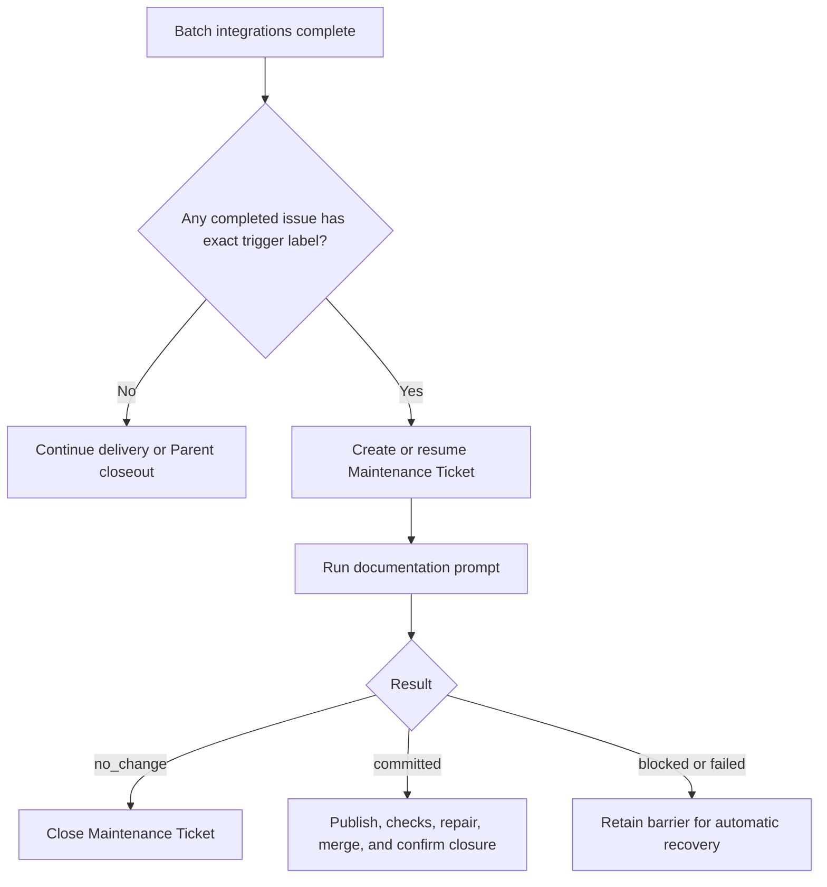
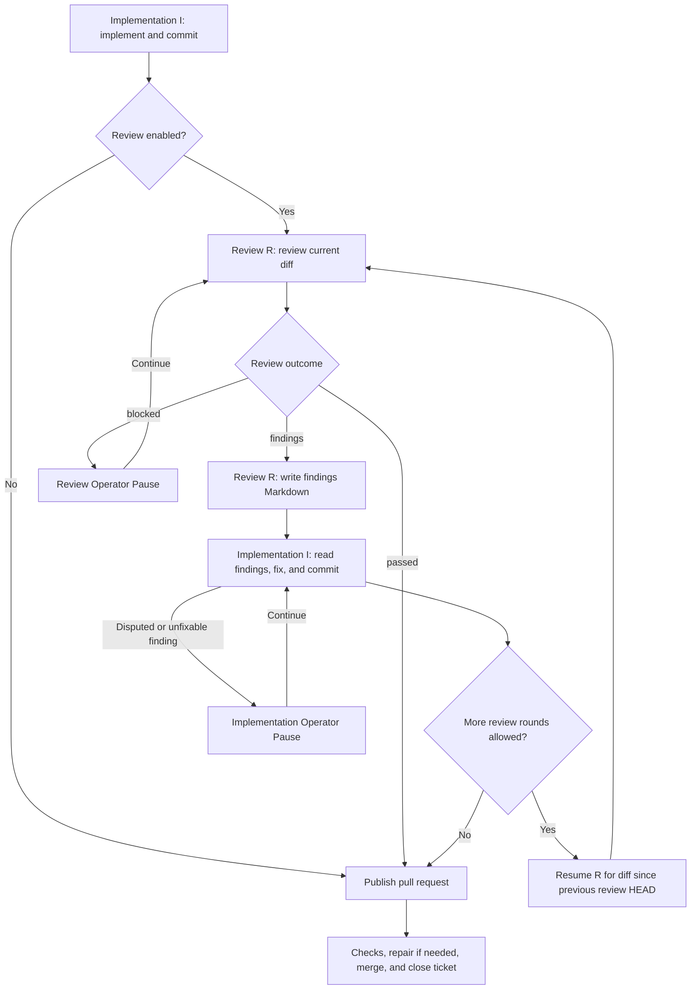

# Project Template

This directory is a project template for Sandcastle Runner. Copy it to `projects/<project-key>` and adapt `config.yaml` and the prompts.

## Configure a Project

Edit the [example config.yaml](sandcastle-runner/config.yaml); its inline comments explain each field and native session lookup options.
Select `codebuddy` through the same role profiles; see [CodeBuddy setup](../README.md#codebuddy-setup) for native options, authentication, permissions, and session storage.
The implementation prompt must be nonempty. Review and documentation prompts are required when their workflow is enabled. CI and conflict repairs use fixed input templates under `src/prompts`; no Project repair prompt is required.

## Operator Pause actions

When automatic recovery stops or an Agent reaches a timeout threshold, the Runner waits for your input. These terminal examples use illustrative paths and diagnostics; `[Enter]` means press Enter without typing text.

### Agent timeout thresholds

`timeouts.agentIdleMinutes` defaults to 10 when omitted. It measures silence on the invocation's stdout and stderr, including partial lines. Runner status, prompt, and diagnostic messages do not reset it. Silence can have several causes; it does not establish that an Agent needs permission.

`timeouts.agentMinutes` remains the required, separately configured overall threshold. The sample's 120 minutes is an example, not a default. Both settings accept finite positive numbers, including fractional minutes. Required-check and merge-queue timeouts retain their existing meanings.

Either Agent threshold opens Operator Pause without stopping the invocation. Its processes keep running and output keeps collecting. Enter keeps waiting on that same invocation and grants a fresh idle window. Overall elapsed time continues from the invocation's launch, and its overall threshold notifies once. A new probe, retry, or continuation starts a new invocation with fresh thresholds.

If the Agent finishes during a pause, Runner retains its original success or failure and logs. After Enter and every pending pause in the Run resolves, normal validation, retry policy, and independent Git verification apply. Enter does not launch a duplicate Agent or consume a retry. Other attempts retain their outcomes while any intervention remains pending; they cannot start another Agent step, verify, publish, or integrate.

These timeout actions apply to session probing, implementation, Review, review fixes, CI repair, conflict repair, and independent or automatic Documentation Maintenance. Timeout pauses support Enter, `k`, and `q`/EOF. `q`/EOF cancels the Run and settles its owned processes and descendants. Cleanup failure fails the Run and blocks retries, continuation, and Worktree cleanup.

Retention lasts within the current Runner process. Recovery Snapshots preserve delivery evidence but do not adopt live Agent processes after a restart. Graceful shutdown closes owned handles; a timeout acknowledgement does not close them.

### Stop one invocation for manual takeover

Use `k` only at the selected invocation's timeout pause. Runner stops that invocation and waits for its CLI and owned descendants to settle. Other active invocations keep collecting output; every queued pause remains independent. Killing work never counts as delivery.

The pause identifies the invocation, provider, native session when known, worktree, diagnostic log, elapsed time, and idle/overall thresholds. Queued entries refresh their state when displayed. A natural completion while queued retains its own outcome.

After confirmed settlement, Runner locates the exact native transcript using the selected provider's configured storage. It displays that path and keeps the intervention pending. Missing or ambiguous lookup blocks takeover and Enter; correct your native storage configuration before a new Run. Failed process settlement fails the Run and blocks replacement execution, retry, continuation, and Worktree cleanup. Do not start a manual CLI when ownership is uncertain.

To handle the settled invocation:

1. Open another terminal in the displayed worktree. Keep the same native session ID, model, native storage/home overrides, and per-Attempt `GIT_CONFIG_GLOBAL` file. Use the selected Project agent profile's permissions and options.
2. Resume the exact session with the native CLI. Do not select the latest session, fork it, or create a missing session. Keep only one writer for that session and worktree.
3. Finish manual handling and **exit the manual CLI** before returning control to Runner, including cancellation.
4. Press Enter in Runner to continue the original task in that exact session. Runner applies its ordinary tagged result validation and independent Git verification. Manual continuation starts a new invocation with fresh thresholds and consumes no Agent Retry budget.

For CodeBuddy, this illustrative command uses dedicated storage and separate allow-rule arguments:

```sh
cd /runner/worktrees/ticket-264
CODEBUDDY_CONFIG_DIR=/runner/native-state \
GIT_CONFIG_GLOBAL=/runner/git-config \
CODEBUDDY_CODE_DISABLE_BACKGROUND_TASKS=1 \
codebuddy --resume session-123 --model deepseek-v4.1-flash \
  --permission-mode dontAsk --allowedTools Read Write Edit Bash
```

Use your displayed paths and native session ID, and preserve your own trusted allow rules. The broad Bash rule above is a tested policy assumption, not a permission default. Our tested CLI refused tools with comma-separated allow rules in manual mode; separate arguments passed. Read the [live evidence and limits](../docs/research/codebuddy-takeover-evidence.md) before relying on a different version or policy.

Runner's pause prevents its own new writers; it cannot discover or control independently launched native CLIs. Pressing Enter acknowledges that you exited manual handling. Enter does not answer an approval request from the terminated process. Recovery Snapshots preserve delivery evidence, not live-process adoption or native-session restoration after restart. Skip and recovery-text actions remain available only in their existing contexts; audit failures still permit only retry or cancellation.

### Continue an Agent session

Use the session, working directory, and diagnostic log to investigate the failure, then enter recovery instructions:

```text
Outcome: blocked
Reason: Required API credentials are missing
Agent: codex
Provider session: session-123
Working directory: /runner/worktrees/ticket-247
Diagnostic log: /runner/logs/implement-247.log
Actions: Enter to continue, s to skip, q to cancel, or provide recovery instructions.
> Credentials are configured. Retry the API request and run the tests.
```

The Runner sends your text to the same session. Pressing Enter sends `continue` instead. JSON input is also recovery text; subsequent results still require normal validation and independent Git verification. These actions apply to implementation, Review, documentation, CI repair, and conflict repair.

### Retry when the Agent session is unavailable

A failed session probe or unusable session offers a fresh attempt:

```text
Outcome: failed
Reason: Agent session is unavailable
Agent: codex
Provider session: unavailable
Working directory: /runner/worktrees/ticket-247
Diagnostic log: /runner/logs/implement-247.log
Actions: Enter to retry, s to skip, q to cancel. Other input is unsupported.
> [Enter]
```

Enter starts a fresh attempt after process settlement. Other text leaves this pause open; `s` skips the current issue, and `q` or EOF cancels the Run.

### Retry or skip an issue operation

After repairing the cause of a failed read or write, press Enter to retry:

```text
Operation failed. Actions: Enter to retry, s to skip Delivery Ticket 247, q/EOF to cancel. Other input is unsupported.
> [Enter]
```

If you choose to stop processing that issue, enter `s` instead:

```text
Operation failed. Actions: Enter to retry, s to skip Delivery Ticket 247, q/EOF to cancel. Other input is unsupported.
> s
```

Other issues continue, and the Run does not select the skipped issue again. Existing PRs, comments, branches, and merges remain. Before publication, the Runner attempts Reservation release; `s` at a failed release abandons it and reports possible residue. Maintenance preparation also permits `s` before its issue exists, skipping that occurrence.

After delivery, `s` skips only the remaining cleanup or release, preserving completed delivery and pending cleanup evidence:

```text
Terminal cleanup for Ticket 247 failed: permission denied Actions: Enter to retry, s to skip remaining cleanup for Ticket 247, q/EOF to cancel. Other input is unsupported.
> s
```

Skipped work and unfinished cleanup make the Run return `incomplete`.

Enter retries reads, creation, label/assignee writes, push, and Worktree creation directly. Creation retries can produce duplicates when an earlier write succeeded without confirmation. Repair partial Worktree state before retrying. Merge retries refresh status and HEAD; already merged or queued work proceeds without another merge request. Check and repair timeouts refresh evidence before waiting or repairing. Closure and publication recovery recheck current state; cleanup retries remaining owned artifacts.

### Retry or cancel a global operation

Startup, discovery, shared Batch fetch, and final Parent closure have no current issue to skip:

```text
Operation failed. Actions: Enter to retry, q/EOF to cancel. Other input is unsupported.
> q
```

Enter retries; `q` or EOF cancels the Run. Other input, including `s` and successful-result JSON, leaves the pause open without retrying or resetting the budget.

### Retry an audit failure

Audit failures permit only retry or cancellation, even while skipping an issue. Enter retries the same log action:

```text
Audit write failed. Enter to retry the same log action, q/EOF to cancel. Other input is unsupported.
> s
Audit write failed. Enter to retry the same log action, q/EOF to cancel. Other input is unsupported.
> [Enter]
```

The Runner does not replay the business action that already completed. Enter `q` or send EOF to cancel. Input cannot accept an audit gap, acknowledge a successful write, or mark cleanup complete.

## Documentation Maintenance workflow

At the normal post-Batch scheduling point, one automatic occurrence is required when at least one successfully delivered issue had the configured `workflow.docMaintainTriggerLabel` when its merged, completed closure was confirmed. Multiple matches in the same Batch still schedule one occurrence. Parent labels, delivery counts, Parent closeout, failed Batches, cancellation, and CI-ready unmerged Pull Requests do not trigger maintenance.



Delivery-time labels are stored in the Recovery Snapshot. On restart, the current `config.yaml` trigger is evaluated against that stored evidence. An empty or newly nonmatching trigger stops continuation without closing or deleting the existing Maintenance Ticket, Pull Request, branch, or Worktree; their recorded locations are reported for manual handling.

`--document` runs one fresh, complete occurrence without a Parent or issue scope. It ignores `issueList`, does not require a trigger label, never resumes prior maintenance, and preserves the ordinary no-change behavior without creating an empty Pull Request.

## Review and implementation loop

Runner uses two independent sessions: implementation I writes code and commits; review R inspects Standards and Spec.



The reviewer writes actionable findings under the Project logs directory and returns the assigned path. A clean review needs no findings document.
Both sessions are reused within one Runner process. Each review receives the issue reference, Worktree, branch, diff boundaries, and findings path through `review-attempt-input.md`. The reviewer reads the issue and repository instructions itself. Subsequent reviews inspect only the latest fix and verify earlier findings were resolved.
At the configured limit, implementation still fixes the final findings before publication, without another review. See `workflow.maxReviewRounds` in [config.yaml](sandcastle-runner/config.yaml) for counting and limits.

Findings and session logs remain available throughout the loop. Completion or skip cleans owned files; pause and cancellation retain them.

## Project prompts

Keep only repository-specific instructions in these files:

- `implement.md`: implementation practices and checks
- `review.md`: review skills and criteria
- `documentation.md`: documentation scope and conventions

Runner templates under `src/prompts` supply task context, Worktree and branch restrictions, review diff boundaries, findings paths, and output protocols.
Project prompts do not need placeholders for these inputs.
