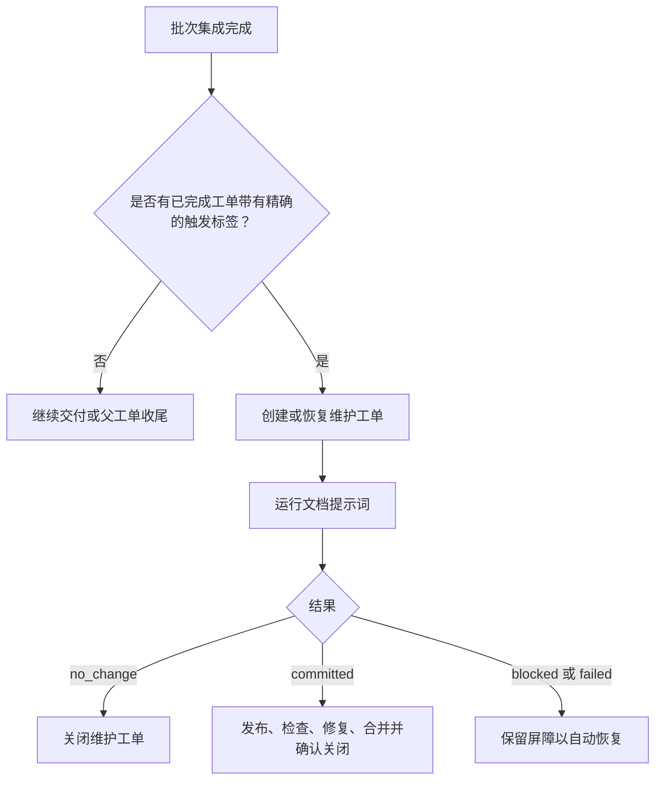
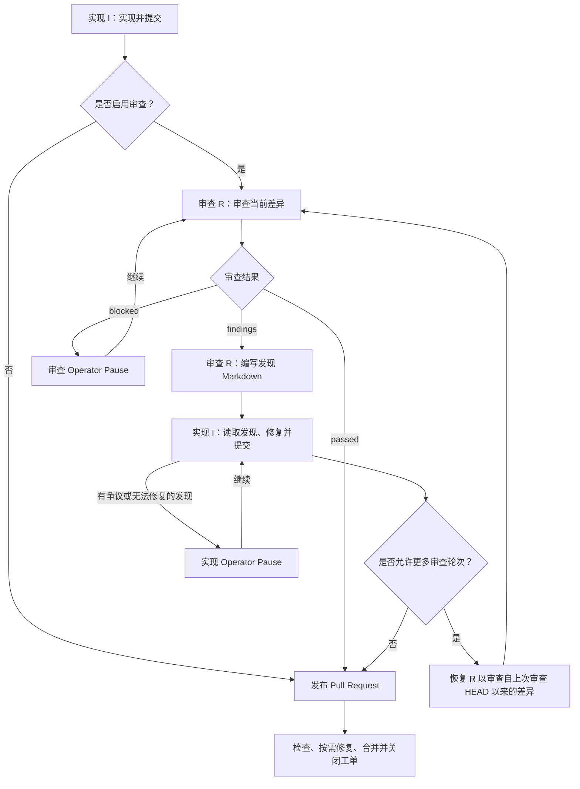

[English](README.md) | [简体中文](README.zh-CN.md)

# 项目模板

本目录是 Sandcastle Runner 的项目模板。将其复制到 `projects/<project-key>`，并调整 `config.yaml` 和提示词。

## 配置项目

编辑[示例 config.yaml](sandcastle-runner/config.yaml)；其行内注释说明每个字段和原生会话查找选项。
实现提示词必须非空。审查和文档提示词在对应工作流启用时为必需项。CI 和冲突修复使用 `src/prompts` 下的固定输入模板；无需项目修复提示词。

## Operator Pause 操作

当自动恢复停止或 Agent 达到超时阈值时，Runner 会等待你的输入。这些终端示例使用示意性路径和诊断信息；`[Enter]` 表示不输入文本直接按 Enter。

### Agent 超时阈值

达到 `timeouts.agentIdleMinutes`（默认值：10）或 `timeouts.agentMinutes` 会打开暂停，同时 Agent 继续运行。按 Enter 继续等待：

```text
Agent idle threshold reached for implement issue 247. Working directory: /runner/worktrees/ticket-247. Diagnostic log: /runner/logs/implement-247.log. Enter to keep waiting on the same invocation or accept its retained outcome; k to stop only this invocation and remain paused; q/EOF to cancel. Other input is unsupported.
Invocation: implement issue 247. Provider: codex. Native session: session-123. State: running; elapsed 600000 ms; idle threshold 600000 ms; overall threshold 7200000 ms.
> [Enter]
```

### 停止单个调用以进行手动接管

在所选调用的超时暂停中输入 `k`：

```text
> k
Selected CLI and owned descendants settled. Runner remains paused for manual native resume.
Provider: codex
Exact native session: session-123
Working directory: /runner/worktrees/ticket-247
Native transcript: /home/runner/.codex/sessions/2026/10/28/session-123.jsonl
GIT_CONFIG_GLOBAL: /runner/git-config
Diagnostic log: /runner/logs/implement-247.log
Exit the manual CLI before pressing Enter to resume the exact session through Runner. q/EOF cancels the Run. Other input is unsupported.
> [Enter]
```

在另一个终端中，使用显示的 Git 配置，从显示的工作目录恢复所显示的原生会话。在 Runner 中按 Enter 继续同一会话前，先退出该 CLI。其他调用会继续运行。

### 继续 Agent 会话

使用会话、工作目录和诊断日志调查失败原因，然后输入恢复指令：

```text
Outcome: blocked
Reason: Required API credentials are missing
Agent: codex
Provider session: session-123
Working directory: /runner/worktrees/ticket-247
Diagnostic log: /runner/logs/implement-247.log
Actions: Enter to continue, s to skip, q to cancel, or provide recovery instructions.
> Credentials are configured. Retry the API request and run the tests.
```

Runner 会将你的文本发送到同一会话。按 Enter 则改为发送 `continue`。JSON 输入同样作为恢复文本；后续结果仍需正常验证和独立的 Git 验证。这些操作适用于实现、审查、文档、CI 修复和冲突修复。

### Agent 会话不可用时重试

会话探测失败或会话不可用时，会提供一次全新的尝试：

```text
Outcome: failed
Reason: Agent session is unavailable
Agent: codex
Provider session: unavailable
Working directory: /runner/worktrees/ticket-247
Diagnostic log: /runner/logs/implement-247.log
Actions: Enter to retry, s to skip, q to cancel. Other input is unsupported.
> [Enter]
```

进程结束确认后，按 Enter 开始全新尝试。其他文本会保持此暂停打开；`s` 跳过当前工单，`q` 或 EOF 取消 Run。

### 重试或跳过工单操作

修复读取或写入失败的原因后，按 Enter 重试：

```text
Operation failed. Actions: Enter to retry, s to skip Delivery Ticket 247, q/EOF to cancel. Other input is unsupported.
> [Enter]
```

如果选择停止处理该工单，改为输入 `s`：

```text
Operation failed. Actions: Enter to retry, s to skip Delivery Ticket 247, q/EOF to cancel. Other input is unsupported.
> s
```

其他工单会继续处理，Run 不会再次选择被跳过的工单。现有的 PR、评论、分支和合并保持不变。发布前，Runner 会尝试释放 Reservation；在释放失败时输入 `s` 会放弃释放，并报告可能的残留。维护准备工作也允许在其工单创建前输入 `s`，跳过该次维护。

交付完成后，`s` 只跳过剩余的清理或释放，保留已完成的交付和待处理的清理证据：

```text
Terminal cleanup for Ticket 247 failed: permission denied Actions: Enter to retry, s to skip remaining cleanup for Ticket 247, q/EOF to cancel. Other input is unsupported.
> s
```

被跳过的工作和未完成的清理会使 Run 返回 `incomplete`。

按 Enter 会直接重试读取、创建、标签/负责人写入、推送和 Worktree 创建。若先前的写入已成功但未获确认，创建重试可能产生重复项。重试前先修复部分完成的 Worktree 状态。合并重试会刷新状态和 HEAD；已合并或已排队的工作会继续推进，不会再次请求合并。检查和修复超时会刷新证据后再等待或修复。关闭和发布恢复会重新检查当前状态；清理会重试剩余的归属产物。

### 重试或取消全局操作

启动、发现、共享批次获取和最终父工单关闭都没有可跳过的当前工单：

```text
Operation failed. Actions: Enter to retry, q/EOF to cancel. Other input is unsupported.
> q
```

按 Enter 重试；`q` 或 EOF 取消 Run。其他输入（包括 `s` 和成功结果 JSON）会保持暂停打开，既不重试，也不重置预算。

### 重试审计失败

审计失败只允许重试或取消，即使在跳过工单期间也是如此。按 Enter 重试同一日志操作：

```text
Audit write failed. Enter to retry the same log action, q/EOF to cancel. Other input is unsupported.
> s
Audit write failed. Enter to retry the same log action, q/EOF to cancel. Other input is unsupported.
> [Enter]
```

Runner 不会重放已经完成的业务操作。输入 `q` 或发送 EOF 以取消。输入无法接受审计缺口、确认写入成功，或将清理标记为完成。

## 文档维护工作流

在批次后的常规调度点，只要至少一个成功交付的工单在确认已合并并完成关闭时带有已配置的 `workflow.docMaintainTriggerLabel`，就需要执行一次自动文档维护。同一批次中有多个匹配项时仍只调度一次。父工单标签、交付数量、父工单收尾、失败的批次、取消，以及已 CI 就绪但未合并的 Pull Request 都不会触发维护。



交付时的标签存储在恢复快照中。重启时，会根据存储的证据评估当前 `config.yaml` 中的触发器。触发器为空或新配置不再匹配时，会停止继续执行，但不会关闭或删除现有的维护工单、Pull Request、分支或 Worktree；其记录的位置会被报告以供手动处理。

`--document` 会在没有父工单或工单范围的情况下运行一次全新、完整的维护。它忽略 `issueList`，不要求触发标签，从不恢复先前的维护，并在不创建空 Pull Request 的情况下保留常规的无变更行为。

## 审查与实现循环

Runner 使用两个独立会话：实现 I 编写代码并提交；审查 R 检查标准与规格。



审查者会在项目日志目录下编写可操作的发现，并返回所分配的路径。无问题的审查无需发现文档。
两个会话在同一个 Runner 进程内复用。每次审查通过 `review-attempt-input.md` 接收工单引用、Worktree、分支、差异边界和发现路径。审查者自行读取工单和仓库说明。后续审查只检查最新修复，并核实先前的发现是否已解决。
达到配置的上限时，实现仍会在发布前修复最终发现，但不再进行审查。计数和限制参见 [config.yaml](sandcastle-runner/config.yaml) 中的 `workflow.maxReviewRounds`。

发现和会话日志在整个循环期间保持可用。完成或跳过会清理归属文件；暂停和取消会保留它们。

## 项目提示词

这些文件中只保留仓库特定的说明：

- `implement.md`：实现实践与检查
- `review.md`：审查技能与标准
- `documentation.md`：文档范围与约定

`src/prompts` 下的 Runner 模板提供任务上下文、Worktree 和分支限制、审查差异边界、发现路径和输出协议。
项目提示词无需为这些输入提供占位符。
