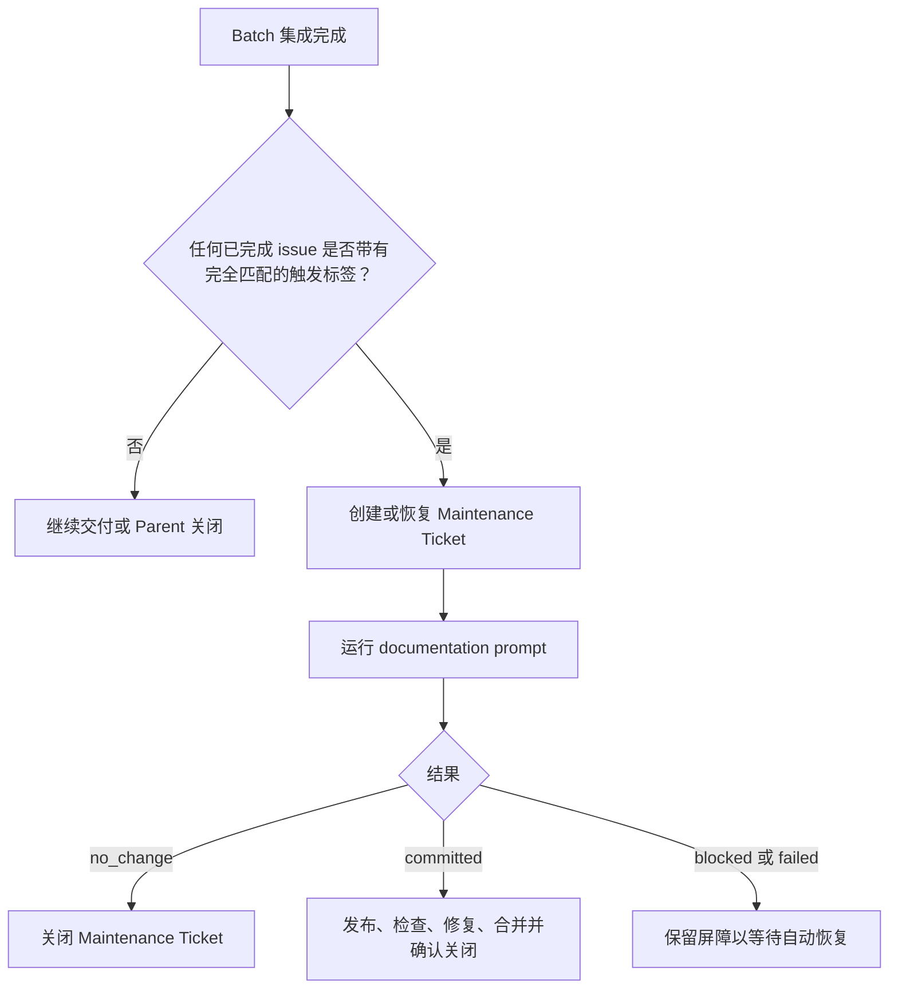
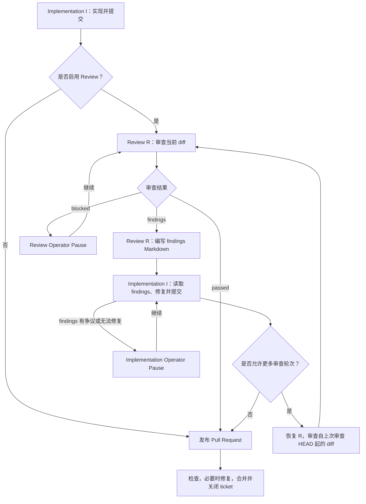

[English](README.md) | 简体中文

# Project 模板

本目录是 Sandcastle Runner 的 Project 模板。将其复制到 `projects/<project-key>`，并调整 `config.yaml` 和 prompts。

## 配置 Project

编辑[示例 config.yaml](sandcastle-runner/config.yaml)；其中的内联注释说明了每个字段以及原生会话查找选项。implementation prompt 必须非空。启用相应工作流时，Review 和 documentation prompt 是必需的。CI 和冲突修复使用 `src/prompts` 下的固定输入模板；无需 Project 修复 prompt。

## Operator Pause 操作

当自动恢复停止或 Agent 达到超时阈值时，Runner 会等待你的输入。以下终端示例使用示意性路径和诊断信息；`[Enter]` 表示按 Enter 而不输入文本。

### Agent 超时阈值

达到 `timeouts.agentIdleMinutes`（默认：10）或 `timeouts.agentMinutes` 会打开暂停，同时 Agent 继续运行。按 Enter 继续等待：

```text
Agent idle threshold reached for implement issue 247. Working directory: /runner/worktrees/ticket-247. Diagnostic log: /runner/logs/implement-247.log. Enter to keep waiting on the same invocation or accept its retained outcome; k to stop only this invocation and remain paused; q/EOF to cancel. Other input is unsupported.
Invocation: implement issue 247. Provider: codex. Native session: session-123. State: running; elapsed 600000 ms; idle threshold 600000 ms; overall threshold 7200000 ms.
> [Enter]
```

### 停止单个调用以进行手动接管

在选定调用的超时暂停处输入 `k`：

```text
> k
Selected CLI and owned descendants settled. Runner remains paused for manual native resume.
Provider: codex
Exact native session: session-123
Working directory: /runner/worktrees/ticket-247
Native transcript: /home/runner/.codex/sessions/2026/10/28/session-123.jsonl
GIT_CONFIG_GLOBAL: /runner/git-config
Diagnostic log: /runner/logs/implement-247.log
Exit the manual CLI before pressing Enter to resume the exact session through Runner. q/EOF cancels the Run. Other input is unsupported.
> [Enter]
```

在另一个终端中，从显示的工作目录使用显示的 Git 配置恢复显示的原生会话。在 Runner 中按 Enter 继续同一会话之前，请退出该 CLI。其他调用继续运行。

### 继续 Agent 会话

使用会话、工作目录和诊断日志调查失败原因，然后输入恢复指令：

```text
Outcome: blocked
Reason: Required API credentials are missing
Agent: codex
Provider session: session-123
Working directory: /runner/worktrees/ticket-247
Diagnostic log: /runner/logs/implement-247.log
Actions: Enter to continue, s to skip, q to cancel, or provide recovery instructions.
> Credentials are configured. Retry the API request and run the tests.
```

Runner 会将你的文本发送到同一会话。按 Enter 则改为发送 `continue`。JSON 输入同样作为恢复文本；后续结果仍需正常验证和独立的 Git 验证。这些操作适用于 implementation、Review、documentation、CI 修复和冲突修复。

### Agent 会话不可用时重试

会话探测失败或会话不可用时会提供一次全新尝试：

```text
Outcome: failed
Reason: Agent session is unavailable
Agent: codex
Provider session: unavailable
Working directory: /runner/worktrees/ticket-247
Diagnostic log: /runner/logs/implement-247.log
Actions: Enter to retry, s to skip, q to cancel. Other input is unsupported.
> [Enter]
```

按 Enter 会在进程处置完成后启动全新尝试。其他文本会让此暂停保持打开；`s` 跳过当前 issue，`q` 或 EOF 取消 Run。

### 重试或跳过 issue 操作

修复读取或写入失败的原因后，按 Enter 重试：

```text
Operation failed. Actions: Enter to retry, s to skip Delivery Ticket 247, q/EOF to cancel. Other input is unsupported.
> [Enter]
```

如果选择停止处理该 issue，则改为输入 `s`：

```text
Operation failed. Actions: Enter to retry, s to skip Delivery Ticket 247, q/EOF to cancel. Other input is unsupported.
> s
```

其他 issue 继续处理，Run 不会再次选择被跳过的 issue。已有的 PR、评论、分支和合并保持不变。发布前，Runner 会尝试释放 Reservation；在释放失败时按 `s` 会放弃释放并报告可能的残留。Maintenance 准备阶段也允许在其 issue 尚不存在时按 `s`，跳过该次维护。

交付完成后，`s` 只跳过剩余的清理或释放，同时保留已完成的交付和待处理清理的证据：

```text
Terminal cleanup for Ticket 247 failed: permission denied Actions: Enter to retry, s to skip remaining cleanup for Ticket 247, q/EOF to cancel. Other input is unsupported.
> s
```

被跳过的工作和未完成的清理会使 Run 返回 `incomplete`。

Enter 会直接重试读取、创建、label/assignee 写入、push 和 Worktree 创建。若先前的写入已成功但未获得确认，创建重试可能产生重复项。重试前请修复不完整的 Worktree 状态。合并重试会刷新状态和 HEAD；已合并或已排队的工作会在不再请求合并的情况下继续。检查和修复超时会在等待或修复前刷新证据。关闭和发布恢复会重新检查当前状态；清理会重试剩余的归属产物。

### 重试或取消全局操作

启动、发现、共享 Batch 获取和最终 Parent 关闭都没有当前 issue 可供跳过：

```text
Operation failed. Actions: Enter to retry, q/EOF to cancel. Other input is unsupported.
> q
```

Enter 重试；`q` 或 EOF 取消 Run。其他输入（包括 `s` 和成功结果 JSON）会让暂停保持打开，既不重试也不重置预算。

### 重试审计失败

审计失败只允许重试或取消，即使正在跳过某个 issue。Enter 会重试同一日志操作：

```text
Audit write failed. Enter to retry the same log action, q/EOF to cancel. Other input is unsupported.
> s
Audit write failed. Enter to retry the same log action, q/EOF to cancel. Other input is unsupported.
> [Enter]
```

Runner 不会重放已经完成的业务操作。输入 `q` 或发送 EOF 以取消。输入不能接受审计缺口、确认写入成功或标记清理完成。

## Documentation Maintenance 工作流

在正常的 Batch 后调度点，当至少一个成功交付的 issue 在确认其已合并并完成关闭时带有配置的 `workflow.docMaintainTriggerLabel`，必须执行一次自动维护。同一 Batch 中有多个匹配项时仍只调度一次。Parent 标签、交付计数、Parent closeout、失败的 Batch、取消以及达到 CI-ready 但未合并的 Pull Request 都不会触发文档维护。



交付时的标签存储在 Recovery Snapshot 中。重启时会用存储的证据评估当前 `config.yaml` 中的触发器。触发器为空或新配置不再匹配时，将停止继续执行，但不会关闭或删除已有的 Maintenance Ticket、Pull Request、分支或 Worktree；其记录的位置会被报告以供手动处理。

`--document` 会在没有 Parent 或 issue 范围的情况下运行一次全新的完整维护。它忽略 `issueList`，不需要触发标签，从不恢复先前的维护，并保留普通的 no-change 行为，不创建空的 Pull Request。

## 审查与实现循环

Runner 使用两个独立会话：implementation I 编写代码并提交；Review R 检查 Standards 和 Spec。



审查者将可操作的 findings 写入 Project 的日志目录，并返回指定路径。干净的审查不需要 findings 文档。两个会话在同一个 Runner 进程内复用。每次审查通过 `review-attempt-input.md` 接收 issue 引用、Worktree、分支、diff 边界和 findings 路径。审查者自行阅读 issue 和仓库说明。后续审查只检查最新的修复，并验证先前的 findings 已解决。达到配置的上限后，implementation 仍会在发布前修复最终的 findings，不再进行下一次审查。计数和上限参见 [config.yaml](sandcastle-runner/config.yaml) 中的 `workflow.maxReviewRounds`。

findings 和会话日志在整个循环期间保持可用。完成或跳过会清理归属文件；暂停和取消会保留它们。

## Project prompts

这些文件只保留仓库特定的说明：

- `implement.md`：实现实践和检查
- `review.md`：审查技能和标准
- `documentation.md`：文档范围和约定

`src/prompts` 下的 Runner 模板提供任务上下文、Worktree 和分支限制、审查 diff 边界、findings 路径和输出协议。Project prompts 无需为这些输入提供占位符。
